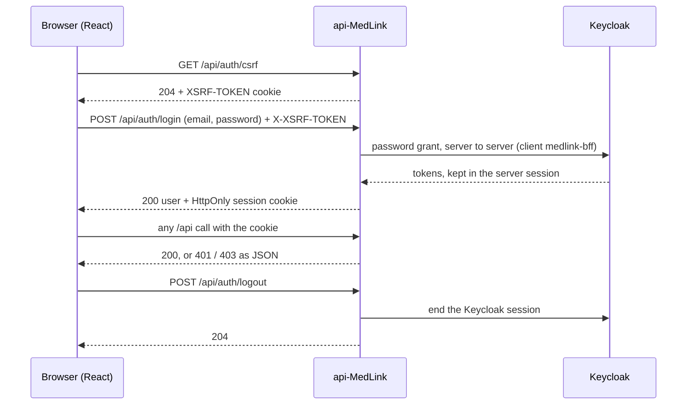

# api-MedLink

[](https://github.com/assali-mohamed-ali/api-MedLink/actions/workflows/ci.yml)
[](https://github.com/assali-mohamed-ali/api-MedLink/actions/workflows/sast-codeql.yml)


The API of **MedLink**, a health portal for patients, practitioners and administrative staff across three
clinics.

> **The browser never talks to Keycloak.** This API is the only component that does. The browser holds an
> HttpOnly session cookie and a readable `XSRF-TOKEN` cookie, never a token, a Keycloak page, link or mail.

## Contents

1. [Quick start](#1-quick-start)
2. [How auth works](#2-how-auth-works)
3. [Project structure](#3-project-structure)
4. [Rules for code](#4-rules-for-code)
5. [From ticket to merge](#5-from-ticket-to-merge)
6. [CI checks](#6-ci-checks)
7. [Environments](#7-environments)
8. [Dev setup in detail](#8-dev-setup-in-detail)
9. [Troubleshooting](#9-troubleshooting)
10. [Security and docs](#10-security-and-docs)

## 1. Quick start

You need **Git** and **Docker Desktop** (running). A JDK 17 is used if present, but not required.

```bash
git clone https://github.com/assali-mohamed-ali/api-MedLink.git
cd api-MedLink
```

| Windows (PowerShell) | macOS / Linux |
|---|---|
| `powershell -ExecutionPolicy Bypass -File .\scripts\setup-dev.ps1` | `./scripts/setup-dev.sh` |

The script creates `.env` with random secrets, starts Postgres, Keycloak and Mailpit, checks the realm, runs
the tests, starts the API and logs in as `patient.dev` to prove the whole chain works. Add `-SkipTests` /
`--skip-tests` for a faster run. **Re-run it after every `git pull`**: it keeps your Keycloak in step with the
team's realm file. All options: [§8](#8-dev-setup-in-detail).

**What you get**

| Service | URL |
|---|---|
| API | http://localhost:8080 |
| Swagger UI | http://localhost:8080/swagger-ui.html |
| Health | http://localhost:8080/actuator/health |
| Mailpit (every mail the API sends in dev) | http://localhost:8025 |
| Keycloak admin console (`admin` / `admin`) | http://localhost:8180 |
| Prometheus (full-stack mode only) | http://localhost:9090 |

**Test users** (dev only): `patient.dev`, `practitioner.dev`, `staff.dev`, all `@medlink.local`, password
`MedLink-Dev-2026!` (the value of `KC_DEV_USERS_PASSWORD`).

**Stack:** Spring Boot 4.1 · Java 17 · Keycloak 26 · PostgreSQL · Flyway · Testcontainers. Package
`com.example.apimedlink`. Do not downgrade a version to make code compile.

## 2. How auth works



- **Session:** a new HttpOnly cookie at login (`SameSite=Strict`, `Secure` in staging/prod). It ends after
  **15 idle minutes**, or as soon as Keycloak refuses to renew the token (account disabled, signed out).
- **CSRF:** every write (`POST`, `PUT`, `DELETE`) echoes the `XSRF-TOKEN` cookie in `X-XSRF-TOKEN`, or gets 403.
- **Password grant:** a consciously accepted exception to the OAuth best practice, so the login stays a
  MedLink page. Why, and what it still needs: [decision record 0001](docs/decisions/0001-login-password-grant.md).

### Endpoints

| Endpoint | Who | Answers |
|---|---|---|
| `GET /api/auth/csrf` | anyone | 204 + `XSRF-TOKEN` cookie |
| `POST /api/auth/register` | anyone | 201, the same whether or not the email is taken (the owner gets a mail) |
| `POST /api/auth/verify-email` | anyone | 204 · 400 `INVALID_TOKEN` · 410 `TOKEN_EXPIRED` |
| `POST /api/auth/verify-email/resend` | anyone | 202, the same whether or not the account exists |
| `POST /api/auth/login` | anyone | 200 · 401 `INVALID_CREDENTIALS` · 403 `EMAIL_NOT_VERIFIED` / `ACCOUNT_DISABLED` |
| `POST /api/auth/logout` | logged in | 204 |
| `GET /api/users` | staff | 200 |
| `GET /api/users/{id}` | the user themself, or staff | 200 · 403 for anyone else, whether the id exists or not |
| `DELETE /api/users/{id}` | staff | 204 |
| `GET /api/users/_health` | logged in | 200 |

Full contracts: [plan.md §4](docs/sprints/sprint-2/plan.md).

### Security rules behind them

| Rule | How |
|---|---|
| One error shape | `{timestamp, status, error, code, message, details}`. 401 `UNAUTHENTICATED` / `SESSION_EXPIRED` (never a redirect), 403 `FORBIDDEN`, 503 `IDENTITY_UNAVAILABLE` when Keycloak is down |
| No account enumeration | public endpoints answer the same for any email; a locked account answers like a wrong password |
| Rate limits | per IP on login, register and resend: 429 `TOO_MANY_REQUESTS` + `Retry-After`, shared by every instance (Postgres). Per account: Keycloak locks after 5 failures for 15 minutes |
| Deny by default | `SecurityConfig`; roles with `@PreAuthorize` and `security/Roles`; own data only with `security/OwnershipGuard` |
| Access matrix | every `/api` route has a line in `functional/AccessMatrixFunctionalTest`. **A route without a line fails the build** |
| Audit trail | every 403 is written to `audit_entries` with the caller, the IP and a redacted path; the table is append-only (triggers) |

## 3. Project structure

```text
src/main/java/com/example/apimedlink/
├── controller/    REST endpoints: validate, then map through mapper/
├── mapper/        entity <-> DTO, called by controllers only
├── service/       business logic on entities (never a DTO)
│                  the only Keycloak callers: KeycloakAdminService, KeycloakLoginClient
├── repository/    Spring Data JPA
├── model/         JPA entities
├── dto/           API records (never a password hash or a token)
├── config/        SecurityConfig, CORS, OpenAPI, Keycloak clients, rate limits
├── security/      Roles, CurrentUser, OwnershipGuard, LoginSessions, session and rate-limit filters,
│                  JSON 401/403 handlers, RouteWords (audit redaction)
└── exception/     GlobalExceptionHandler, ErrorBody

src/main/resources/
├── application.properties     every profile: session, cookies, mail, rate limits, Keycloak
├── application-dev.yml        local
├── application-staging.yml    pre-prod
├── application-prod.yml       prod
└── db/migration/              Flyway V*__*.sql

src/test/java/.../functional/  real API + Keycloak + Postgres + Mailpit, driven over HTTP like a browser
keycloak/realm-medlink.json    the realm: roles, groups, clients, lockout, dev users
scripts/setup-dev.ps1 / .sh    one-command dev setup (keep both in step)
docs/                          sprint plan and report, decisions, Postman collection
```

## 4. Rules for code

| Topic | Rule |
|---|---|
| **Ids** | One id per person, Keycloak's: `users.id` = the `sub` claim. Create the Keycloak user first, never generate a user id. Other entities generate a UUID |
| **Roles** | `PATIENT`, `PRACTITIONER`, `ADMINISTRATIVE_STAFF`, given through Keycloak groups. One role per person: `Patient extends User` (JPA `JOINED`). Never take a role or an id for the caller's own account from a request body |
| **Layers** | Controller validates and maps; services take and return entities or plain values; only `KeycloakAdminService` and `KeycloakLoginClient` call Keycloak |
| **New endpoint** | DTO + mapper + service + controller + **a line in the access matrix** + a test for the right role and one for the wrong role |
| **Schema** | Flyway only: a new `V<N>__name.sql` with the next free number (check open PRs; the lower number merges first). Never edit a merged migration |
| **Realm** | Change `keycloak/realm-medlink.json` in a PR, not only in your admin console |
| **Secrets** | From environment variables only. Never log a password, token, code or secret |
| **Tests** | Functional test first (`FunctionalTestBase`): commit it red, make it green, check once that it fails when the rule breaks. MockMvc only for what cannot be reached on demand |

## 5. From ticket to merge

Tasks live in YouTrack, project `MLink` (https://medlink.youtrack.cloud).

1. **Start:** move the task to *In Progress*. Shared file (`SecurityConfig`, `AuthBffController`,
   `FunctionalTestBase`, the realm file, the setup scripts)? Say on the teammates' tickets what you change.
2. **Branch from `master`:**
   ```bash
   git checkout master && git pull
   git checkout -b feat/short-description        # or fix/, docs/, chore/
   ```
   Work on an epic shares one branch, `epic/MLink-<n>`: `git pull` before you start and before you push,
   never force-push.
3. **Commit**, one per task, with the YouTrack id:
   ```bash
   git commit -m "feat: what changed" -m "MLink-79"   # feat: fix: docs: chore: refactor: test:
   ```
4. **Check before the PR:**
   ```bash
   ./mvnw -B verify                                           # needs Docker
   ./mvnw -B test -Dsurefire.runOrder=reversealphabetical     # CI does not run your class order
   ```
   Changed an endpoint? Run the Postman collection in `docs/postman/` with `npx newman@6.2.1 run <file>`.
5. **Open the PR against `master`**, never on another branch (a stacked PR may never reach `master`).
   Fill the template honestly, update `docs/sprints/sprint-2/report.md`, and move the task to *To Verify*
   with the PR link.
6. **AI disclosure:** if an AI tool helped, tick *"J'ai utilisé des outils d'IA générative…"*; tick
   *"Je confirme avoir relu…"* yourself once you have reviewed the changes. Both must be in the same state.
7. **Review:** `master` needs the code owner's approval (@assali-mohamed-ali) and CodeQL. You cannot merge
   your own PR. Merged → the task goes to *Done*.

## 6. CI checks

| Check | Workflow | If red |
|---|---|---|
| Build + tests | `ci.yml` | run `./mvnw verify` locally in both class orders |
| AI disclosure | `ai-disclosure.yml` | both AI checkboxes present once, in the same state |
| CodeQL | `sast-codeql.yml` | fix the flagged pattern; never suppress without a comment |
| Dependency CVEs | `sca-dependency-check.yml` | upgrade (fails on CVSS ≥ 7), or a justified suppression in `security/owasp-suppressions.xml` |
| Secrets | `secrets-scan.yml` | remove and rotate the secret |
| Image + config | `container-scan.yml` (Trivy) | bump the base image or fix the Dockerfile |
| DAST | `dast-zap.yml` | fix the endpoint; `security/zap-rules.tsv` only with a reason |
| Publish + deploy | `cd.yml` | env-gated image build, immutable digest, compose rollout over SSH, health check (staging, production) |

Local secrets check: `gitleaks detect --source . --config security/.gitleaks.toml --redact -v`.
Optional: `pre-commit run --all-files`.

**Dependabot** opens grouped PRs every Monday (Maven, GitHub Actions, Dockerfile and compose images). Review
them like any PR: compose images are not what the tests use, so a green CI proves little for them.
**Never merge a Java jump** (`pom.xml` `java.version=17` moves first), and keep the Maven wrapper on 3.9.x
(IntelliJ cannot import the project with 3.10, MLink-118).

## 7. Environments

| Branch | Environment | Profile | Env file |
|---|---|---|---|
| `master` | integration | `dev` locally | `.env` (made by the setup script) |
| `staging` | pre-prod | `staging` | `.env.staging` |
| `prod` (or a `v*` tag) | production | `prod` | `.env.prod` |

Maintainers promote `master` → `staging` → `prod` with `--no-ff` merges. Production secrets live in GitHub
Environments, never in git. CD builds one image per run and deploys its immutable digest to the target
host with Docker Compose over SSH; setup, secrets, rollback and recovery are in
[`docs/DEPLOYMENT.md`](docs/DEPLOYMENT.md).

## 8. Dev setup in detail

<details>
<summary><b>Setup script options</b></summary>

| Windows | macOS / Linux | What it does |
|---|---|---|
| *(none)* | *(none)* | containers, realm check, `./mvnw verify`, API, login check |
| `-SkipTests` | `--skip-tests` | the same without the tests |
| `-FullStack` | `--full-stack` | everything in containers, API and Prometheus included (no JDK needed) |
| `-Reset` | `--reset` | delete the dev volumes first: fresh Keycloak and database |
| `-KeepData` | `--keep-data` | never delete the dev volumes, even when the realm file changed |
| `-Stop` | `--stop` | stop the API and the containers (volumes kept) |

From Command Prompt: `powershell -NoProfile -ExecutionPolicy Bypass -File .\scripts\setup-dev.ps1 -SkipTests`.
Logs of the last run: `%TEMP%\medlink-setup` (Windows) or `$TMPDIR/medlink-setup`.

- **JDK:** the script finds a JDK 17+ and uses it for this run only. Without one it switches to full-stack mode.
- **Realm changes:** when `keycloak/realm-medlink.json` changed, it deletes the dev volumes and re-imports
  the realm. It first saves your realm to `.dev/realm-backups/` (no users, secrets masked, 10 kept).

</details>

<details>
<summary><b>Two compose files, one job each</b></summary>

| Setup | File | Command | Secrets |
|---|---|---|---|
| **A. Coding** (API on your machine) | `compose.yaml`: Postgres, Keycloak + its DB, Mailpit | `SPRING_PROFILES_ACTIVE=dev ./mvnw spring-boot:run` | fixed dev values, matching `application-dev.yml` |
| **B. Full stack** (all in containers) | `docker-compose.yml`: the same + the API image + Prometheus | `docker compose -f docker-compose.yml up --build` | all from `.env`, required |

The shared services must stay identical in both files (`ComposeFilesTest` fails when they drift).
`compose.yaml` also defines the API under the `full` profile: `docker compose --profile full up --build`
gives a zero-config dev stack with the fixed dev secrets, without touching the coding setup. Staging and
prod use file B with `--env-file .env.staging` or `.env.prod`.

</details>

<details>
<summary><b>When dev data is kept or deleted</b></summary>

Volumes: `pgdata` (app database) and `keycloak-db-data` (Keycloak).

| You run | Volumes |
|---|---|
| the setup script again, same setup | **kept** |
| the setup script after the realm file changed | **deleted** (realm saved first) |
| the setup script in the other setup (A ↔ B) | **deleted** (realm saved first) |
| `-Reset` / `--reset` | **deleted** (realm saved first) |
| `-KeepData` / `--keep-data` | **kept**, even after a realm change |
| `-Stop` / `--stop`, or `docker compose -f <file> down` | **kept** |
| `docker compose -f <file> down -v` | **deleted**, no backup |

After checking out a branch with other migrations, re-run with `-Reset` if Flyway refuses to start.

</details>

<details>
<summary><b>Keycloak details</b></summary>

- Realm `medlink` is imported from `keycloak/realm-medlink.json` only into an empty database; the setup
  script re-imports it whenever the file changed.
- Roles come from the groups `/patients`, `/practitioners`, `/administrative-staff` (new users land in
  `/patients`). At login the API keeps only the three MedLink roles, so a new role needs code
  (`security/Roles`, access rules, matrix lines).
- Clients: `medlink-bff` (confidential, password grant, browser flow off) logs users in;
  `medlink-admin` is the service account for admin calls (create a user, set a password, mark an email verified).
- Delete the dev users in staging and prod after the first start.

</details>

## 9. Troubleshooting

| Symptom | Fix |
|---|---|
| `Free these ports first` | something uses 8080 or 8180; stop it, or `-Stop` if it is an earlier run of ours |
| `release version 17 not supported` | your default Java is older than 17: point `JAVA_HOME` at a JDK 17 (the setup script does it by itself) |
| `mvnw` not recognized in PowerShell | type `.\mvnw` |
| `Could not find a valid Docker environment` | start Docker Desktop (the tests use Testcontainers) |
| `keycloak-db-1 exited (1)`, log says `in 18+, these Docker images…` | the compose files run PostgreSQL 18 with a PostgreSQL 16 volume path; `-Reset` does not help. Tracked on #74 |
| `... must be set` from compose | `.env` is missing or incomplete: run the setup script, or copy `.env.example` |
| roles look wrong, or `staff.dev` cannot log in | your Keycloak holds an old realm: re-run the setup script, or `-Reset` |
| 401 with the right password | 5 wrong passwords lock the account for 15 minutes, answered like a wrong password: wait, or unlock it in the console |
| a file shows fully modified after pull | line endings, normalized by `.gitattributes`; a `chore: normalize` commit is fine |
| `permission denied: ./scripts/setup-dev.sh` | `chmod +x scripts/setup-dev.sh` |
| a Spring Boot test class "is missing" | Spring Boot 4 moved them (`AutoConfigureMockMvc` → `org.springframework.boot.webmvc.test.autoconfigure`); don't downgrade |

## 10. Security and docs

**Report a vulnerability privately**, never in a public issue: see [SECURITY.md](SECURITY.md)
(`security@medlink.example.com`, or a DM to @assali-mohamed-ali starting with `[SECURITY]`).

Known open item: Swagger and `/v3/api-docs` are public in production (GitHub #65). In staging and prod the
actuator (metrics, `/actuator/health`) is only on the private management port 9000, never published; the public
port keeps `/livez` and `/readyz` (GitHub #49). The
actuator exposes only `health,info,prometheus`: don't open more without a security review.

| Document | What is in it |
|---|---|
| [CLAUDE.md](CLAUDE.md) | the team's rules, for people and AI sessions |
| [docs/sprints/sprint-2/report.md](docs/sprints/sprint-2/report.md) | **Status**: what is merged, open, next; decisions log |
| [docs/sprints/sprint-2/README.md](docs/sprints/sprint-2/README.md) | how a working session runs |
| [docs/sprints/sprint-2/plan.md](docs/sprints/sprint-2/plan.md) | design and endpoint contracts |
| [docs/decisions/](docs/decisions/) | decision records |
| [docs/ARCHITECTURE.md](docs/ARCHITECTURE.md), [security/threat-model.md](security/threat-model.md) | architecture, trust boundaries, threats and controls mapped to code and tests |
| [docs/DEPLOYMENT.md](docs/DEPLOYMENT.md) | staging/production host, GitHub Environment secrets, rollout, rollback and recovery |
