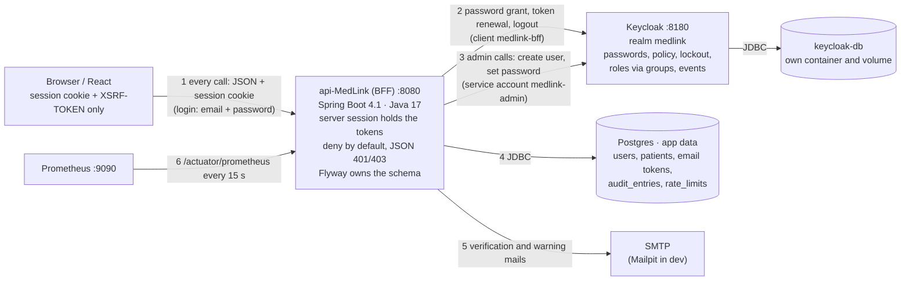
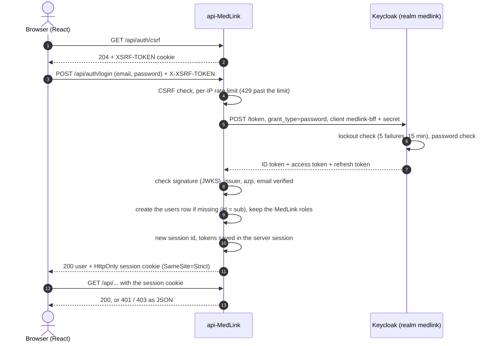
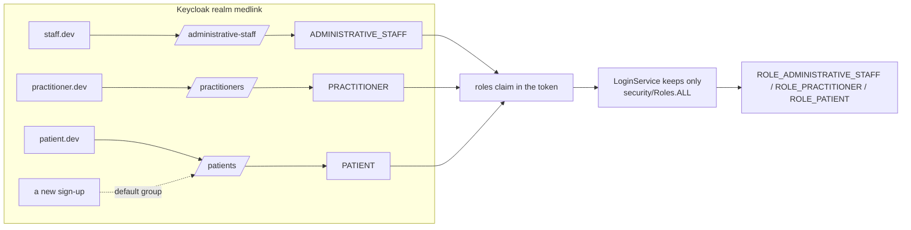
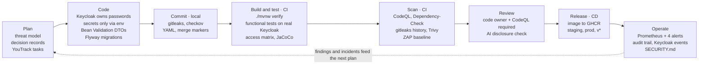
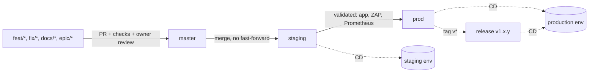

# api-MedLink — Architecture and security

Updated 2026-10-20 against `master` (GitHub #66). Setup and day-to-day commands: [README](../README.md).
Threats and controls: [security/threat-model.md](../security/threat-model.md). An older interactive copy of
this guide exists as a [Claude Doc](https://claude.ai/code/artifact/f497ba3c-3de8-4b1f-af36-fb47ed612524)
(2026-10-09); this file is the reference.

## TL;DR

api-MedLink is a Spring Boot 4.1 / Java 17 health API. **Keycloak owns identity** (passwords, policy,
lockout, roles) and the API is an **auth BFF**: the browser holds a session cookie only, and **never talks to
Keycloak**. Sign-up, email verification, login and logout go browser → API → Keycloak → API → browser; staff
codes, password changes and account management will too.

- **Login:** `POST /api/auth/login`; the API asks Keycloak with the **OAuth password grant**, server to
  server. This is a consciously accepted exception to the OAuth best practice, chosen so that no Keycloak
  page reaches the browser: [decision record 0001](decisions/0001-login-password-grant.md) (GitHub #50).
- **Authorization:** deny by default, roles from the signed token, "own data only" checks, and a role × route
  matrix that fails the build when a route has no rule.
- **Delivery:** security checks at every stage (local hooks, six scans in CI, owner review), promotion
  `master` → `staging` → `prod`.
- **Where we are:** sprint 2 builds the identity features; plan, contracts and progress are in
  [`docs/sprints/sprint-2/`](sprints/sprint-2/README.md).

The ISO 27001 section maps the repo's technical controls to Annex A. The repo supplies evidence for an ISMS;
it does not make the organisation certified on its own.

## Architecture

Seven runtime components, two databases: identity lives in Keycloak, business data in the API's Postgres,
and they never share storage.

1. The browser only ever calls the API. At login it sends the email and password to the API.
2. The API logs the user in at Keycloak (password grant), renews the token while the session lives, and
   ends the Keycloak session at logout. Tokens are checked (signature, issuer, `azp`) and stay in the server
   session.
3. Account operations use a separate service account, `medlink-admin`.
4. Keycloak and the API each have their own database and volume.
5. Mails (verification links, "someone used your address") are the API's own, not Keycloak's.
6. Prometheus scrapes the metrics (public in production for now: GitHub #49).

The browser never needs to reach Keycloak. Its port 8180 is for admins in dev; the API reaches Keycloak
internally at `http://keycloak:8080`. Staging and prod run the same images with different `.env` values and
Spring profiles.

## Authentication and authorization

Keycloak decides who you are and which groups you belong to; the API keeps the MedLink roles from the signed
token and enforces every rule. The API stores no password and no role.

### Login flow (password grant)

- **Refusals:** a wrong password, an unknown email and a locked account all get the same
  401 `INVALID_CREDENTIALS` (no account enumeration). An unverified email: 403 `EMAIL_NOT_VERIFIED`, and the
  Keycloak session just opened is ended. A disabled account: 403 `ACCOUNT_DISABLED`. Keycloak down: 503.
- **Never logged:** the password, the tokens (`LoginRequest` and `KeycloakTokens` hide them in `toString`).
- **Session life:** 15 idle minutes (Tomcat, and Keycloak's SSO idle). While it lives, the API renews the
  5-minute access token; if Keycloak refuses (account disabled, signed out, password reset) the session
  ends with 401 `SESSION_EXPIRED`.
- **Logout:** `POST /api/auth/logout` ends Keycloak's session (refresh token, server to server) and ours,
  and expires the cookie: 204.
- **Planned:** a second factor (TOTP) for practitioners and staff, handled by the API (MLink-62/63), forced
  password change and history (MLink-87/88/91).

Why the password grant, its costs and the plan should it be revisited:
[decision record 0001](decisions/0001-login-password-grant.md).

### Access model: groups → roles → rules

The API checks access in four layers:

| Layer | Where | What it does |
|---|---|---|
| Deny by default | `config/SecurityConfig` | every route needs a session, except the public auth endpoints, health/info, API docs and metrics |
| Role | `@PreAuthorize("hasRole(...)")` with `security/Roles` | e.g. only staff list or delete users |
| Ownership | `security/OwnershipGuard` | a user reads only their own record; checked before the lookup, so the same 403 whether the id exists or not |
| Proof | `functional/AccessMatrixFunctionalTest` | one line per `/api` route × anonymous, patient, practitioner, staff; a route without a line fails the build (MLink-60, #77) |

Every 403 is written to the audit trail (`audit_entries`, append-only).

- **Roles are given through groups, never to users directly.** Moving someone from `/patients` to
  `/practitioners` is one change, and every holder of a role can be listed from its group.
- **One role per person:** `Patient extends User` (JPA `JOINED`); a practitioner is another subclass.
- **Role changes apply at the next login,** because the roles are read from the token issued at login.
- **Staff hold no Keycloak admin rights:** `ADMINISTRATIVE_STAFF` is a plain realm role, so staff manage
  accounts only through the API, under its rules and audit trail. Only the API's service account `medlink-admin`
  holds `realm-management` rights (threat model E3, GitHub #80, fixed in #81).

### How to add a role

A new role now needs code, on purpose: the API ignores any role it does not know.

1. Realm (`keycloak/realm-medlink.json`, in a PR): the realm role, e.g. `NURSE`, and a group `/nurses` holding it.
2. `security/Roles`: the constant, and add it to `ALL` so the login keeps it.
3. Rules: `@PreAuthorize("hasRole('" + Roles.NURSE + "')")` on the endpoints it may call.
4. Tests: a column in the access matrix, plus a test for the right and the wrong role.

The realm file is imported **only when the realm does not exist yet**. In staging and prod the console is the
source of truth after the first start; export the realm to update the file. In local dev the file is the
source of truth: the setup script re-imports it whenever it changed.

## The why behind each setup

Every choice below trades a little simplicity for less attack surface or less custom security code. Check its
reason before changing one; the dated decisions are in the
[sprint report's decisions log](sprints/sprint-2/report.md#decisions-log).

| Decision | Why | Rejected alternative / trade-off |
| --- | --- | --- |
| Keycloak as identity provider | Proven server for password policy, brute-force lockout, events and an admin UI; no password code of ours | Custom JWT (removed): hand-rolled tokens, no revocation, password hashes in our DB |
| The frontend never talks to Keycloak | Users never see Keycloak; one place to secure, test and audit every identity flow | Skinned Keycloak pages (decided 2026-10-11, superseded 2026-10-14) |
| Login by password grant, server to server, confidential client | The only standard way to log in without a Keycloak page; tokens never leave the API | Authorization Code + PKCE (the standard, but a Keycloak page): see decision 0001. Cost: the API sees passwords, and second factors are ours to build |
| Auth BFF: tokens kept server-side | A script in the browser (XSS) cannot steal what the browser never holds | Tokens in the SPA. Cost: server sessions, so more instances need shared sessions |
| Session cookie HttpOnly, `SameSite=Strict`, `Secure` in staging/prod; CSRF token on writes | The cookie is the browser's only credential | `Lax` (needed only for a redirect login, which no longer exists) |
| Same answer for any email on public endpoints | Nobody can test which emails have an account; the real owner gets a mail instead | 409 `EMAIL_TAKEN`, 423 `ACCOUNT_LOCKED` |
| Per-IP rate limits counted in Postgres | Shared by every instance and race-free with the database we already run | Redis; an in-memory map (one instance, racy) |
| Separate `keycloak-db` container + volume | Identity data isolated from business data: separate credentials, backups, upgrades | One shared Postgres |
| `users.id` = Keycloak id; one role per person | One id per person, no mapping table; a person is a patient or a practitioner or staff | Our own id + `keycloak_id`; several profiles per login |
| Audit trail append-only in the database | "Not changed or deleted from the application" must hold for raw SQL too | A save-and-read-only repository only (the owner role limit is GitHub #57) |
| Explicit OIDC endpoints, not `issuer-uri` | The API starts even when Keycloak is down (tests, CI, DAST) | Discovery makes Keycloak a hard startup dependency |
| 401 and 403 as JSON, never a redirect | React needs a code, not an HTML login page | Spring's redirect or empty 401 |
| Flyway owns the schema, `ddl-auto: validate` | Schema changes are reviewed as code | `ddl-auto: update` silently changes production tables |
| Profiles `dev` / `staging` / `prod`, secrets from env only | The same image runs everywhere; a missing Keycloak secret stops startup outside dev | Defaults baked into config (the datasource still has some: GitHub #64) |
| Pinned versions (Java 17, image tags) | Reproducible builds; Dependabot proposes bumps as reviewable PRs | `latest` tags change under your feet |
| Functional tests against real Keycloak, Postgres, Mailpit (Testcontainers) | Prove behaviour end to end over HTTP, like a browser | Mocked Keycloak; H2 in-memory |
| Non-root container user + healthcheck | Least privilege at runtime; orchestrators restart an unhealthy app | |

## Codebase map

Code lives under `src/main/java/com/example/apimedlink/`. `.github/CODEOWNERS` gives every path to the code
owner, and names the security-sensitive ones explicitly: the `config/` and `security/` packages, `.github/`,
`docker/`, `terraform/` and the root `security/` folder.

| Path | What it holds | Touch it when |
| --- | --- | --- |
| `controller/` | REST endpoints, thin: validation, then entity ↔ DTO through a mapper. `AuthBffController` (csrf, register, verify), `LoginController`, `LogoutController`, `UserController` | Adding an endpoint (+ a matrix line) |
| `mapper/` | Entity ↔ DTO conversion, called by controllers only | Changing what the API exposes |
| `service/` | Business logic on entities, never a DTO. `KeycloakLoginClient` (password grant, logout) and `KeycloakAdminService` are the only Keycloak callers | Adding behaviour |
| `repository/`, `model/` | Spring Data JPA and entities (`User`, `Patient extends User`, `AuditEntry`...) | Adding a table |
| `dto/` | Records for API input/output; never a password hash or a token | Changing what the API exposes |
| `config/` | `SecurityConfig` (rules, CSRF, 401/403 handlers), CORS, OpenAPI, Keycloak clients, rate limits | Changing who can call what (code owner review) |
| `security/` | `Roles`, `CurrentUser`, `OwnershipGuard`, `LoginSessions`, `SessionValidityFilter`, `RateLimitFilter`, JSON 401/403 handlers, `RouteWords` | Changing sessions or access checks |
| `exception/` | `GlobalExceptionHandler`, `ErrorBody` (the one error shape) | Adding an error type |
| `resources/application*.properties/yml` | Base config; per-profile DB, cookies, CORS, actuator, logging | Environment-specific settings |
| `resources/db/migration/` | Flyway `V1`–`V8` on `master` | Any schema change: the next free `V<N>__...`, never edit a merged file |
| `keycloak/realm-medlink.json` | Realm, roles, groups, clients, lockout, events, dev users | Changing identity settings (in a PR) |
| `compose.yaml` / `docker-compose.yml` | Dev dependencies / full stack (kept alike by `ComposeFilesTest`) | Adding a service |
| `docker/` | Multi-stage `Dockerfile` (non-root), `Dockerfile.dev` | Changing the image |
| `.github/workflows/` | CI, AI disclosure, SAST, SCA, secrets, container scan, DAST, CD | Changing the pipeline |
| `security/` (repo root) | gitleaks, checkov, trivy, ZAP rules, OWASP suppressions, threat model | Tuning a scanner (with a reason) |
| `monitoring/` | Prometheus config, 4 alert rules, Grafana dashboard | Adding metrics or alerts |
| `terraform/` | Docker-provider IaC for the app container (still the old `JWT_SECRET`: GitHub #53) | Changing deployment |

Tests: `src/test/java/.../functional/` drives the real API over HTTP against Keycloak, Postgres and Mailpit
(`FunctionalTestBase`); `integration/`, MockMvc and unit tests mirror the packages. Docker must be running.

## DevSecOps in the SDLC

| Control | Tool and file | Runs | Effect today |
| --- | --- | --- | --- |
| Threat model | STRIDE with controls mapped to code, `security/threat-model.md` | At design time, updated with the code | Guides reviews |
| Decisions | `docs/decisions/`, the report's decisions log | Per decision | Reasons kept with the code |
| Review gate | ruleset on `master`, `.github/CODEOWNERS`, PR template | Every PR | Code-owner approval and CodeQL required; merge commits only |
| AI disclosure | `ai-disclosure.yml`, `.github/scripts/validate-ai-disclosure.mjs` | Every PR | Fails unless exactly one usage choice is checked; AI use also requires the human review acknowledgment |
| Local hooks | `.pre-commit-config.yaml`: whitespace, YAML, large files, merge markers, gitleaks, checkov | Every commit once `pre-commit install` ran | Blocks the commit |
| Build + tests | `ci.yml`: `./mvnw -B verify`, JaCoCo | Push/PR on `master`, `staging`, `prod` | Fails the run |
| SAST | `sast-codeql.yml`: CodeQL `security-extended` + `security-and-quality` | Push, PR, Mondays | Required on `master` |
| SCA | `sca-dependency-check.yml`: OWASP Dependency-Check (NVD); Trivy fallback when `NVD_API_KEY` is absent, reported in the log, summary and artifact | Push, PR, Mondays | Fails on CVSS ≥ 7; release branches fail on the fallback unless `ALLOW_TRIVY_FALLBACK=true` |
| Secrets | `secrets-scan.yml`: gitleaks on the full history | Every push and PR, daily | Fails the run |
| Container + IaC | `container-scan.yml`: Trivy config and image | Push/PR | Fails on HIGH/CRITICAL |
| DAST | `dast-zap.yml`: ZAP baseline against the running app | PRs, pushes to `master`/`staging`, Mondays | Fails on FAIL rules; unauthenticated only |
| Dependency updates | `dependabot.yml`: Maven, Actions, Dockerfile and compose images, 7-day cooldown | Mondays | Opens grouped PRs, reviewed like any PR |
| Release + deploy | `cd.yml`: image to GHCR; GitHub Environments `staging` / `production`, `terraform validate` | Push to `staging`, `prod`, tags `v*` | Image published; no `terraform apply` yet (GitHub #47) |
| Monitoring | `monitoring/`: alerts AppDown, 5xx > 5 %, p95 > 1 s, heap > 90 % | Continuous | Alerts reach no one: Alertmanager has no target |
| Audit | `audit_entries` (every 403), Keycloak events (logins, lockouts) | Continuous | Stored; reading the trail: MLink-115 |
| Vulnerability intake | `SECURITY.md` | On report | Private disclosure path |

SonarQube settings exist (`sonar-project.properties`), but no workflow runs Sonar.

## Environments & branching

Code moves one way, feature branch → `master` → `staging` → `prod`, and each environment gets the same image
with its own profile and secrets.

| Environment | Branch | Spring profile | Env file | Keycloak mode | Where secrets live |
| --- | --- | --- | --- | --- | --- |
| Local dev | any | `dev` | `.env` (made by the setup script) | `start-dev` | Your `.env` (git-ignored) |
| Staging | `staging` | `staging` (port 8081) | `.env.staging` | `start` behind an HTTPS proxy | GitHub Environment `staging` |
| Production | `prod`, tags `v*` | `prod` | `.env.prod` | `start` behind an HTTPS proxy | GitHub Environment `production` |

- **Never push directly** to `master`, `staging` or `prod`; never base a PR on another branch than `master`.
- **Secrets never enter git.** `.env*` files are ignored except the `*.example` templates.
- **Fail fast:** the Keycloak client secrets have no default outside dev, so a missing secret stops startup.
  The datasource credentials still have defaults (GitHub #64).

## ISO/IEC 27001:2022 mapping

The repository implements or evidences 25 Annex A controls: 14 covered, 8 partial, 3 gaps. That is technical
evidence for an ISMS, not certification, which also needs the organisational clauses 4–10 (scope, risk
treatment, Statement of Applicability, policies, awareness, internal audit, management review).

| Annex A control | How api-MedLink implements it | Evidence in the repo | Coverage | Gap / next action |
| --- | --- | --- | --- | --- |
| 5.8 Information security in project management | Threat model mapped to code; decision records; security checklist on every PR | `security/threat-model.md`, `docs/decisions/`, PR template | Covered | Review the threat model with each feature |
| 5.15 Access control | Deny by default; roles; ownership checks; role × route matrix | `config/SecurityConfig.java`, `security/OwnershipGuard.java`, `AccessMatrixFunctionalTest` | Covered | Metrics and API docs public in production (GitHub #49, #65) |
| 5.16 Identity management | One identity store (Keycloak); `users.id` = Keycloak id; one role per person | realm, `V3__users_keycloak_id_as_pk.sql` | Covered | |
| 5.17 Authentication information | Passwords only in Keycloak; policy 12+ characters, mixed, not the email; never logged by the API | realm `passwordPolicy`, `LoginRequest.toString` | Covered | Password history and forced change: MLink-87/88 |
| 5.18 Access rights | Roles through groups; new users in `/patients`; no role accepted from requests | realm `groups`, `defaultGroups`, `security/Roles` | Partial | Periodic review of group membership |
| 8.2 Privileged access rights | Admin calls only through a dedicated service account (staff hold no Keycloak admin rights, #81); actuator limited to health/info/prometheus | realm, `application-*.yml` | Partial | MFA for staff and the bootstrap admin (MLink-62/63, GitHub #68) |
| 8.4 Access to source code | CODEOWNERS on security paths; ruleset on `master` (owner review, CodeQL) | `.github/CODEOWNERS`, README | Covered | Same protection for `staging`/`prod` |
| 8.5 Secure authentication | Password grant server to server (accepted exception, decision 0001); lockout after 5 failures for 15 min; per-IP limits; 15-minute idle session; HttpOnly, Strict, Secure cookies; new session id at login | realm, `RateLimitFilter`, `LoginSessions`, `application*.yml` | Partial | No second factor yet; TLS ends at a proxy not in the repo |
| 8.8 Management of technical vulnerabilities | Dependabot; Dependency-Check, Trivy and CodeQL blocking; private disclosure | `.github/dependabot.yml`, workflows, `SECURITY.md` | Covered | |
| 8.9 Configuration management | Infrastructure and config as code; pinned versions; checkov and Trivy config scans; compose files kept alike by a test | `docker/`, compose files, `terraform/`, `ComposeFilesTest` | Covered | |
| 8.12 Data leakage prevention | gitleaks before commit, in CI and daily; tokens never in the browser; no body or token in logs; audit paths redacted | `security/.gitleaks.toml`, `secrets-scan.yml`, `security/RouteWords.java` | Covered | |
| 8.13 Information backup | Named volumes `pgdata` and `keycloak-db-data` | compose files | Gap | Backup and tested restore for both databases (GitHub #67) |
| 8.15 Logging | Append-only audit trail of refusals; Keycloak login and admin events (30 days); per-profile application logs | `V7__audit_entries.sql`, `AuditService`, realm events | Partial | Logins and account operations in the trail (MLink-114, MLink-72); central log store |
| 8.16 Monitoring activities | Prometheus metrics; 4 alert rules | `monitoring/` | Gap | Route alerts: Alertmanager has no target |
| 8.24 Use of cryptography | Tokens signed by Keycloak, checked via JWKS with issuer and `azp`; email tokens stored as SHA-256 hashes | `KeycloakLoginClient`, `V5__email_tokens.sql` | Partial | Document TLS and encryption at rest for both databases |
| 8.25 Secure development life cycle | Controls at every SDLC stage; functional tests first | `.github/workflows/`, `.pre-commit-config.yaml` | Covered | |
| 8.26 Application security requirements | Threat model controls mapped to tests; endpoint contracts | `security/threat-model.md`, `docs/sprints/sprint-2/plan.md` | Covered | |
| 8.27 Secure architecture and engineering | BFF (no tokens in the browser, no Keycloak in the browser), least privilege, isolated identity DB, deny by default | this document, `SecurityConfig`, compose files | Covered | |
| 8.28 Secure coding | CodeQL `security-extended`; Bean Validation; JPA bound parameters; code review | `sast-codeql.yml`, `dto/`, `repository/` | Covered | |
| 8.29 Security testing in development and acceptance | Functional tests on real Keycloak incl. refusals, access matrix, mutation checks; SAST, SCA; ZAP baseline | `functional/`, `ci.yml`, `dast-zap.yml` | Partial | ZAP is unauthenticated; move its rules from WARN to FAIL |
| 8.31 Separation of development, test and production | Profiles, branches, GitHub Environments, separate secrets; throwaway test containers | README, `cd.yml`, `application-*.yml` | Covered | |
| 8.32 Change management | PR-only changes, owner review, versioned migrations, decision records, tagged releases | CODEOWNERS, `db/migration/`, `docs/decisions/`, `cd.yml` | Covered | |
| 8.33 Test information | Testcontainers creates throwaway databases; dev users are fictitious | `TestcontainersConfiguration.java`, realm users | Partial | Dev users are imported in every environment: delete them in staging/prod |
| 5.24 / 6.8 Incident management and event reporting | Private vulnerability disclosure; audit trail and Keycloak events as evidence | `SECURITY.md`, `audit_entries` | Partial | Write an incident response runbook |
| 5.34 Privacy and protection of PII | Data minimisation: no passwords or roles in the API; PII kept out of logs and the audit trail; no account enumeration | V2 migration, `RouteWords`, threat model | Gap | Data classification, retention rules, a GDPR/health-data processing register |

## Known gaps & next steps

The prioritised list, with the threat behind each item, is in
[the threat model, §6](../security/threat-model.md#6-open-work-by-priority). In short:

- [ ] Second factor for practitioners and staff (MLink-62/63); MFA for admin identities (GitHub #68)
- [ ] No default database credentials outside dev (GitHub #64)
- [ ] Metrics and API docs not public in production (GitHub #49, #65)
- [ ] Separate database roles for the audit trail (GitHub #57)
- [ ] Logins and account operations in the audit trail (MLink-114, MLink-72)
- [ ] Backup and tested restore of both databases (GitHub #67)
- [ ] Terraform and CD aligned with the Keycloak BFF (GitHub #53, #47); Keycloak and `keycloak-db` in the deployment
- [ ] Reverse proxy: TLS, HSTS, CSP, `TRUSTED_PROXIES`, Keycloak not public
- [ ] Alert routing and a central log store; shared sessions before a second API instance
- [ ] Delete the `*.dev` users in staging and prod after the first start

Done since the first version of this guide: login, logout and session expiry through the API, negative
authorization tests and the access matrix, per-IP rate limits, Keycloak events, the audit trail of refusals,
blocking SCA and Trivy, cookie hardening, `postgres:latest` pinned, staff without Keycloak admin rights (#81).

## Rules of the road, FAQ & glossary

### Rules

1. One YouTrack task per change; branch from `master` (`feat/`, `fix/`, `docs/`, `chore/`, or the shared
   `epic/MLink-<n>`); PR to `master`, never stacked; fill the template honestly, including the AI disclosure.
2. Never store or accept a password or a role in the API, and never take the caller's role or id from a request body.
3. New endpoint = DTO + mapper + service + controller + a line in the access matrix + a test for the right role
   and one for the wrong role. Services never return a DTO.
4. Schema change = the next free `V<N>__description.sql`. Never edit a merged migration.
5. Secrets only through env. Never log a password, token, code or secret.
6. Functional tests first: commit red, make green, check once that the test fails when the rule breaks.
7. Never suppress a scanner finding without a comment, an expiry date and a ticket.
8. Do not open more Actuator endpoints without a security review.
9. Do not merge a Java version jump from Dependabot; review compose image bumps by running the stack.
10. Report vulnerabilities privately per `SECURITY.md`, never in a public issue.

### FAQ & troubleshooting

| Symptom | Cause | Fix |
| --- | --- | --- |
| `/api/...` returns 401 `UNAUTHENTICATED` | No session, or it expired (15 idle minutes) | Log in with `POST /api/auth/login` |
| 401 `SESSION_EXPIRED` in the middle of work | Keycloak refused to renew the token (disabled, signed out, password reset) | Log in again |
| POST/PUT/DELETE returns 403 | Missing CSRF header | `GET /api/auth/csrf`, then send the `XSRF-TOKEN` cookie value as `X-XSRF-TOKEN` |
| 429 `TOO_MANY_REQUESTS` | Per-IP limit on login, register or resend | Wait for `Retry-After`; dev has high limits |
| 401 with the right password | 5 failures locked the account for 15 minutes (answered like a wrong password) | Wait, or unlock the user in the Keycloak console |
| A new role does not show up | Unknown to `security/Roles`, or roles are read at login | Add it to `Roles.ALL`; log out and in again |
| Realm changes in the JSON are ignored | The realm already exists; import runs only once | Local dev: re-run the setup script. Elsewhere: change it in the console |
| Tests fail to start | Docker is not running (Testcontainers) | Start Docker Desktop |
| The build fails on `everyApiRouteHasALineInTheMatrix` | A route without an access rule | Add its line to `MATRIX` in `AccessMatrixFunctionalTest` |

### Glossary

| Term | Meaning |
| --- | --- |
| BFF | Backend For Frontend: the backend runs the login and keeps the tokens; the browser holds only a session cookie |
| OIDC | OpenID Connect, the identity protocol on top of OAuth 2.0 that Keycloak speaks |
| Password grant (ROPC) | Resource Owner Password Credentials: the client sends the user's password to the token endpoint. Deprecated by OAuth 2.1; used here server to server as an accepted exception (decision 0001) |
| PKCE | Proof Key for Code Exchange, part of the Authorization Code flow; not used by our login (see decision 0001) |
| Realm | An isolated Keycloak space with its own users, roles, groups and clients (`medlink`) |
| Client | An application registered in Keycloak: `medlink-bff` (login), `medlink-admin` (service account) |
| JWKS | The public keys Keycloak publishes so the API can verify token signatures |
| IDOR | Insecure Direct Object Reference: reading someone else's data by changing an id; stopped by `OwnershipGuard` |
| SAST / SCA / DAST | Static code analysis / dependency CVE scanning / attacks against the running app |
| SoA | Statement of Applicability: the ISO 27001 list of chosen Annex A controls and why |
