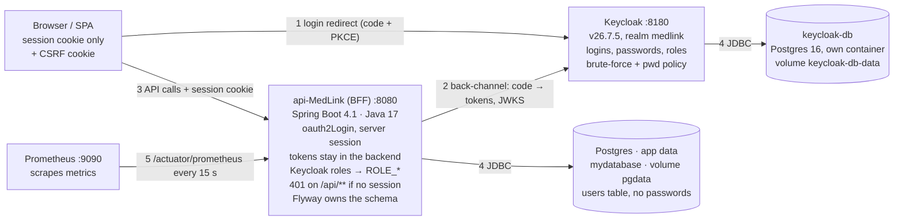
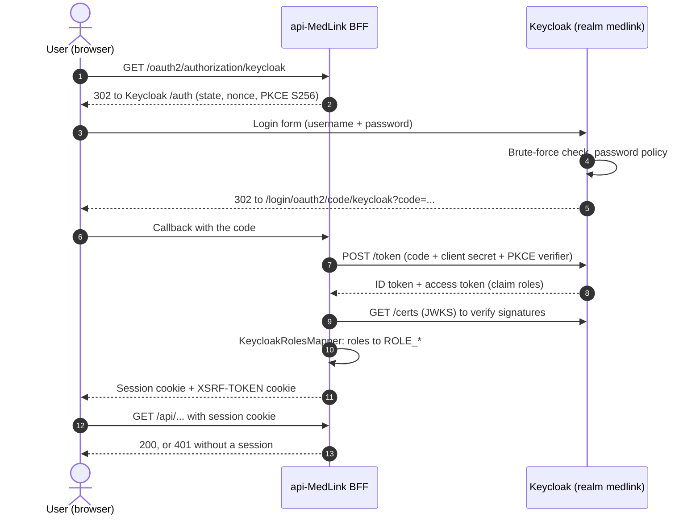
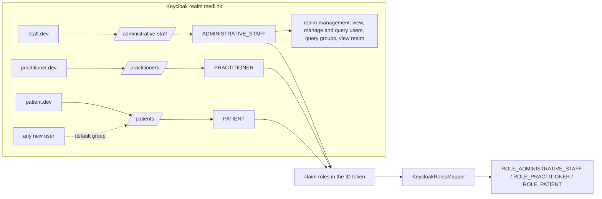
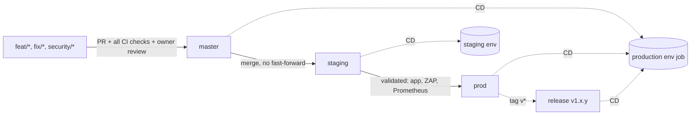

# api-MedLink — Architecture, Security & Onboarding Guide

As of 2026-10-09 · living copy (with editable diagrams and the coverage tracker):
[Claude Doc](https://claude.ai/code/artifact/f497ba3c-3de8-4b1f-af36-fb47ed612524)

## TL;DR

api-MedLink is a Spring Boot 4.1 / Java 17 health API where **Keycloak owns identity** (logins, passwords, roles) and the backend acts as an **auth BFF**: the browser only ever holds a session cookie. Security is built into every step of delivery: local hooks, six security scans in CI, and promotion through `master` → `staging` → `prod`.

- **State today:** Keycloak, its realm and the BFF skeleton are initialised on branch `feat/keycloak-init`. Feature APIs come next.
- **How to read this:** new to the team → read *Day-1 onboarding*, then *Architecture* and *Rules of the road*. Reviewing security or compliance → jump to *DevSecOps in the SDLC* and *ISO 27001 mapping*.

The ISO 27001 section maps the repo's technical controls to Annex A. The repo supplies evidence for an ISMS; it does not make the organisation certified on its own.

## Day-1 onboarding

Five steps take a new developer from clone to a running stack and a first PR.

**One-command shortcut:** the setup script runs steps 1–4 and checks everything (realm, tests, login), with no configuration. Windows: `powershell -ExecutionPolicy Bypass -File .\scripts\setup-dev.ps1`. macOS / Linux: `./scripts/setup-dev.sh`. It finds a JDK 17+ by itself (or lets Docker build the API when there is none) and re-imports the realm when `keycloak/realm-medlink.json` changed.

**Prerequisites:** Docker Desktop and Git. For coding: JDK 17 (Temurin), an IDE with Lombok support, and optionally `pre-commit` (`pip install pre-commit`) and `gitleaks`.

1. Clone and prepare secrets
   - `git clone https://github.com/assali-mohamed-ali/api-MedLink.git && cd api-MedLink`
   - `cp .env.example .env`, then fill every `change-me` value. `.env` is git-ignored and must never be committed.
   - `pre-commit install` (once) so the local checks run on every commit.
2. Start the dependencies (Option A, recommended for coding)
   - `docker compose -f compose.yaml up -d` starts Postgres, Keycloak and Keycloak's own database.
   - `SPRING_PROFILES_ACTIVE=dev ./mvnw spring-boot:run` starts the API.
3. Or run everything in containers (Option B)
   - `docker compose -f docker-compose.yml up --build` adds the app image and Prometheus. It refuses to start until the `.env` secrets are set.
4. Check it works
   - `./mvnw -B verify` runs build, tests (Testcontainers needs Docker) and coverage.
5. Make a first change
   - Branch `feat/...`, commit, push, open a PR to `master`, fill the PR checklist. See *Rules of the road*.

| What | URL | Login |
| --- | --- | --- |
| API | http://localhost:8080 | via Keycloak |
| Start login | http://localhost:8080/oauth2/authorization/keycloak | test users below |
| Swagger UI | http://localhost:8080/swagger-ui.html | public |
| Health | http://localhost:8080/actuator/health | public |
| Keycloak admin console | http://localhost:8180 | `admin` / `admin` (compose.yaml) or `KEYCLOAK_ADMIN` / `KEYCLOAK_ADMIN_PASSWORD` |
| Prometheus (Option B) | http://localhost:9090 | none |

**Test users (dev only):** `staff.dev`, `practitioner.dev`, `patient.dev`. Password = `KC_DEV_USERS_PASSWORD` (`MedLink-Dev-2026!` with `compose.yaml`).

## Architecture

Six runtime components, two databases: identity lives in Keycloak, business data lives in the API's Postgres, and the two never share storage.

1. **Login:** the browser is redirected to Keycloak (authorization code + PKCE).
2. **Back-channel:** the BFF swaps the code for tokens and checks their signature (JWKS).
3. API calls carry only the session cookie; tokens never reach the browser.
4. **JDBC:** Keycloak and the API each have their own database and volume.
5. Prometheus scrapes `/actuator/prometheus` every 15 s.

The BFF is the only component that talks to both Keycloak and the app database. Keycloak's port 8180 is for browsers and admins; the API reaches it internally at `http://keycloak:8080`. Staging and prod run the same images with different `.env` values and Spring profiles.

## Authentication & authorization

Keycloak decides who you are and which groups you belong to; the BFF only turns the signed `roles` claim into Spring authorities. The API stores no password and no role.

### Login flow (authorization code + PKCE)

### Access model: users → groups → roles → authorities

- **Roles are given through groups, never to users directly.** Moving someone from `/patients` to `/practitioners` is one change in the console, and every holder of a role can be listed from its group.
- **`ADMINISTRATIVE_STAFF` is a realm admin, not a Keycloak super-admin.** It can manage users and groups in `medlink` only; the bootstrap `admin` account in the master realm stays separate.
- **Role changes apply at the next login,** because the roles are read from the ID token issued at login.

### How to add a role (no backend change needed)

1. In the Keycloak console (or `keycloak/realm-medlink.json` for new environments), create the realm role, e.g. `NURSE`.
2. Create a group `/nurses` and map the role to it.
3. Add users to the group. They get `ROLE_NURSE` at their next login.
4. Protect endpoints with it: `.requestMatchers("/api/care/**").hasRole("NURSE")` in `SecurityConfig`, or `@PreAuthorize("hasRole('NURSE')")` once `@EnableMethodSecurity` is added (not enabled yet).

The realm file is imported **only when the realm does not exist yet**. In staging and prod the console is therefore the source of truth after the first start; export the realm if you want the file updated. In local dev the file is the source of truth: the setup script re-imports it (and wipes the dev volumes) whenever it changed, so change the realm through the file in a PR, not only in your console.

## The why behind each setup

Every choice below trades a little simplicity for less attack surface or less custom security code. When you want to change one, check its reason first.

| Decision | Why | Rejected alternative / trade-off |
| --- | --- | --- |
| Keycloak as identity provider | Proven OIDC server with password policy, brute-force lockout, MFA and an admin UI. No auth code of ours to maintain | Custom JWT (removed): hand-rolled token code, no revocation, password hashes in our DB |
| Auth BFF: tokens kept server-side | A health app must not expose tokens to browser JavaScript; an XSS bug cannot steal what the browser never holds | Tokens in the SPA (public client) is simpler, but exposes them. Cost: server sessions, so scaling out will need shared sessions (e.g. Spring Session) |
| Confidential client + PKCE S256 | A stolen authorization code is useless without the verifier and the client secret | Implicit flow and password grant are disabled in the realm |
| Separate `keycloak-db` container + volume | Identity data is isolated from business data: separate credentials, backups and upgrades; the volume keeps realm and users across restarts | One shared Postgres: fewer containers, but one breach or bad migration hits both |
| `--import-realm` from `keycloak/realm-medlink.json` | Any new environment boots with the same realm, roles and client; existing realms are never overwritten | Re-importing on every start would wipe changes made in the console |
| Roles via groups + one generic mapper | New roles need no code; `ADMINISTRATIVE_STAFF` is limited to user management in its own realm | A hard-coded `role` column (dropped in V2) |
| No password or role in the API database | Data minimisation and a single source of truth for identity | Kept columns would drift from Keycloak and widen the breach impact |
| Explicit OIDC endpoints, not `issuer-uri` | The API starts even when Keycloak is down (tests, CI, DAST); browser and backend use different Keycloak URLs inside Docker | Discovery needs less config but makes Keycloak a hard startup dependency |
| CSRF on, SPA cookie mode | Session cookies are sent automatically, so CSRF tokens are required | The old stateless JWT setup had CSRF disabled |
| 401 on `/api/**`, redirect elsewhere | An SPA needs a status code, not an HTML login page | |
| Flyway owns the schema, `ddl-auto: validate` | Schema changes are reviewed as code; Hibernate never alters the database | `ddl-auto: update` silently changes production tables |
| Profiles `dev` / `staging` / `prod`, secrets from env only | The same image runs everywhere; staging/prod fail at startup if a secret is missing | Defaults baked into config would ship to prod |
| Pinned versions (Keycloak 26.7.5, Postgres 16, Java 17) | Reproducible builds; Dependabot proposes bumps as reviewable PRs | `latest` tags change under your feet |
| Non-root container user + healthcheck | Least privilege at runtime; orchestrators can restart an unhealthy app | |
| Testcontainers for tests | Tests hit a real Postgres, so migrations and SQL behave as in prod | H2 in-memory differs from Postgres |

## Codebase map

Code lives under `src/main/java/com/example/apimedlink/`; everything security-related sits in `config/`, `security/` and the files listed in `.github/CODEOWNERS`.

| Path | What it holds | Touch it when |
| --- | --- | --- |
| `controller/` | REST endpoints, thin, validation only. `AuthBffController` is an empty skeleton | Adding an endpoint |
| `service/` | Business logic (`UserService`) | Adding behaviour |
| `repository/`, `model/` | Spring Data JPA interfaces and entities (`User.id` is the Keycloak user id, no password) | Adding a table |
| `dto/` | Records for API input/output | Changing what the API exposes |
| `config/` | `SecurityConfig` (oauth2Login, CSRF, public paths), `CorsConfig` | Changing who can call what (code owner review) |
| `security/` | `KeycloakRolesMapper` (Keycloak roles → `ROLE_*`) | Rarely; roles are added in Keycloak |
| `exception/` | `GlobalExceptionHandler` (404 / 409 / 400 JSON errors) | Adding an error type |
| `resources/application.properties` | Base config + Keycloak client registration | Changing Keycloak URLs or client |
| `resources/application-{dev,staging,prod}.yml` | Per-environment DB, CORS, actuator, logging, client secret | Environment-specific settings |
| `resources/db/migration/` | Flyway: `V1__init.sql`, `V2__keycloak_users.sql`, `V3__users_keycloak_id_as_pk.sql` | Any schema change: add `V4__...`, never edit an old file |
| `keycloak/realm-medlink.json` | Realm, roles, groups, `medlink-bff` client, dev users | Bootstrapping new environments |
| `compose.yaml` / `docker-compose.yml` | Dev dependencies / full stack | Adding a service |
| `docker/` | Multi-stage `Dockerfile` (non-root), `Dockerfile.dev` (debug port 5005) | Changing the image |
| `.github/workflows/` | CI, SAST, SCA, secrets, container scan, DAST, CD | Changing the pipeline |
| `security/` (repo root) | gitleaks, checkov, trivy, ZAP rules, OWASP suppressions, threat model | Tuning a scanner (with a reason) |
| `monitoring/` | Prometheus config, 4 alert rules, Grafana dashboard JSON | Adding metrics or alerts |
| `terraform/` | Docker-provider IaC for the app container | Changing deployment |

Tests mirror the packages under `src/test/java/` (`controller/`, `service/`, `security/`, `integration/`) and most use Testcontainers, so Docker must be running.

## DevSecOps in the SDLC

Security is checked at eight stages, from a local commit hook to production alerts. Three checks currently only report, and do not block (marked *report-only* below).

```mermaid
flowchart LR
  PLAN["Plan<br/>STRIDE threat model<br/>PR checklist<br/>CODEOWNERS review"]
  CODE["Code<br/>Keycloak, no own auth<br/>secrets only via env<br/>Bean Validation DTOs<br/>Flyway migrations"]
  COMMIT["Commit · local<br/>gitleaks protect<br/>checkov IaC scan<br/>YAML + merge markers<br/>large-file check"]
  BUILD["Build and test · CI<br/>./mvnw verify<br/>unit + integration<br/>Testcontainers DB<br/>JaCoCo coverage"]
  SCAN["Scan · CI<br/>CodeQL SAST<br/>Dependency-Check SCA<br/>gitleaks full history<br/>Trivy config + image"]
  REL["Release<br/>image pushed to GHCR<br/>tags: sha, branch, v*<br/>Dependabot weekly PRs"]
  DEP["Deploy<br/>GitHub Environments<br/>terraform validate<br/>ZAP DAST on staging"]
  OPS["Operate<br/>Prometheus + 4 alerts<br/>actuator health<br/>SECURITY.md reporting"]
  PLAN --> CODE --> COMMIT --> BUILD --> SCAN --> REL --> DEP --> OPS
  OPS -. "alerts, scan findings and incidents feed the next plan" .-> PLAN
```

| Control | Tool and file | Runs | Effect today |
| --- | --- | --- | --- |
| Threat model | STRIDE table, `security/threat-model.md` | At design time | Guides reviews |
| Review gate | `.github/pull_request_template.md`, `.github/CODEOWNERS` | Every PR | Owner review on `config/`, `security/`, `docker/`, `terraform/`, `.github/` |
| Local hooks | `.pre-commit-config.yaml`: whitespace, YAML, large files, merge markers, gitleaks, checkov | Every `git commit` once `pre-commit install` was run | Blocks the commit |
| Build + tests | `ci.yml`: `./mvnw -B verify`, JaCoCo | Push/PR on `master`, `staging`, `prod`, `main`, `develop` | Fails the run |
| SAST | `sast-codeql.yml`: CodeQL `security-extended` + `security-and-quality` | Push, PR, Mondays 03:00 UTC | Findings in the GitHub Security tab |
| Secrets | `secrets-scan.yml`: gitleaks on full history | Every push and PR, daily 05:00 UTC | Fails the run |
| SCA | `sca-dependency-check.yml`: OWASP Dependency-Check | Push, PR, Mondays 04:00 UTC | *Report-only* (`\|\| true`), SARIF + HTML report |
| Container + IaC | `container-scan.yml`: Trivy config scan + image scan, HIGH/CRITICAL | Push/PR | *Report-only* (no exit code set), SARIF uploaded |
| DAST | `dast-zap.yml`: ZAP baseline against the running app | Push to `master`/`staging`, Mondays 02:00 UTC, manual | Fails on FAIL rules; current rules are WARN/INFO |
| Dependency updates | `dependabot.yml`: Maven, Actions, Docker, grouped, 7-day cooldown | Mondays 06:00 | Opens PRs; Java 17 pinned |
| Release | `cd.yml`: image to GHCR, tagged sha / branch / semver | Push to `master`, `staging`, `prod`, tags `v*` | Image published |
| Deploy | `cd.yml`: GitHub Environments `staging` / `production`, `terraform fmt` + `validate` | After release | Validation only, no `terraform apply` yet |
| Monitoring | `monitoring/`: Prometheus, alerts AppDown, 5xx > 5 %, p95 > 1 s, heap > 90 % | Continuous | *Report-only*: Alertmanager has no targets, so alerts reach no one |
| Vulnerability intake | `SECURITY.md` | On report | Private disclosure path |

SonarQube settings exist (`sonar-project.properties`), but no workflow runs Sonar yet. Making the *report-only* rows blocking is listed in *Known gaps*.

## Environments & branching

Code moves one way, `feature/*` → `master` → `staging` → `prod`, and each environment gets the same image with its own profile and secrets.

| Environment | Branch | Spring profile | Env file | Keycloak mode | Where secrets live |
| --- | --- | --- | --- | --- | --- |
| Local dev | any | `dev` | `.env` from `.env.example` | `start-dev` | Your `.env` (git-ignored) |
| Staging | `staging` | `staging` (port 8081) | `.env.staging` | `start` behind HTTPS proxy | GitHub Environment `staging` |
| Production | `prod`, tags `v*` | `prod` | `.env.prod` | `start` behind HTTPS proxy | GitHub Environment `production` |

- **Never push directly** to `master`, `staging` or `prod`. One PR = one topic.
- **Secrets never enter git.** `.env*` files are ignored except the `*.example` templates; gitleaks checks every commit and the full history daily.
- **Staging and prod fail fast:** `KEYCLOAK_CLIENT_SECRET` has no default there, so a missing secret stops startup instead of running insecurely.
- **Watch out:** `cd.yml` also runs the `production` job on pushes to `master`, before staging has validated the change. Confirm this is intended; today that job only validates Terraform.

## ISO/IEC 27001:2022 mapping

The repository implements or evidences 25 Annex A controls: 10 covered, 12 partial, 3 gaps. That is technical evidence for an ISMS, not certification. Certification also needs the organisational clauses 4–10: ISMS scope, risk assessment and treatment, a Statement of Applicability (SoA), policies, awareness, internal audit and management review. Use this table as input to the SoA and update the Coverage column as gaps close.

| Annex A control | How api-MedLink implements it | Evidence in the repo | Coverage | Gap / next action |
| --- | --- | --- | --- | --- |
| 5.8 Information security in project management | STRIDE threat model; security checklist on every PR | `security/threat-model.md`, `.github/pull_request_template.md` | Covered | Review the threat model each release |
| 5.15 Access control | Deny by default: every request needs a session except health, info, API docs and metrics | `config/SecurityConfig.java` | Covered | |
| 5.16 Identity management | One identity store (Keycloak); the API uses the Keycloak user id as the primary key of `users`, with no id of its own | `keycloak/realm-medlink.json`, `V3__users_keycloak_id_as_pk.sql` | Covered | |
| 5.17 Authentication information | Passwords live only in Keycloak; policy: 12+ chars, upper, lower, digit, special, not username/email | realm `passwordPolicy`, V2 drops `users.password` | Covered | |
| 5.18 Access rights | Roles granted through groups; new users default to `/patients`; no role accepted from requests | realm `groups`, `defaultGroups` | Partial | Define a periodic access review of group membership |
| 8.2 Privileged access rights | `ADMINISTRATIVE_STAFF` limited to user management in its realm; bootstrap admin separate; Actuator limited to health/info/prometheus | realm `roles`, `application-*.yml` | Partial | Enforce MFA (OTP) for `ADMINISTRATIVE_STAFF` and the bootstrap admin |
| 8.4 Access to source code | CODEOWNERS on security-sensitive paths; PR-only flow | `.github/CODEOWNERS`, README | Partial | Verify branch protection on `master`/`staging`/`prod` in GitHub settings |
| 8.5 Secure authentication | OIDC code + PKCE S256, confidential client, brute-force lockout after 5 failures, 30 min idle / 10 h max session | realm settings, `application.properties` | Partial | MFA not enforced; TLS terminates at a proxy that is not in the repo |
| 8.8 Management of technical vulnerabilities | Dependabot weekly; OWASP Dependency-Check, Trivy, CodeQL; private disclosure | `.github/dependabot.yml`, workflows, `SECURITY.md` | Partial | Make SCA and Trivy fail on HIGH/CRITICAL |
| 8.9 Configuration management | Infrastructure and config as code; pinned versions; checkov and Trivy config scans | `docker/`, compose files, `terraform/`, `security/checkov.yaml` | Covered | |
| 8.12 Data leakage prevention | gitleaks before commit, in CI and daily on full history; `.env` git-ignored; DTOs expose no secrets | `security/.gitleaks.toml`, `secrets-scan.yml`, `.gitignore` | Covered | |
| 8.13 Information backup | Named volumes `pgdata` and `keycloak-db-data` | compose files | Gap | Write and test a backup + restore procedure for both databases |
| 8.15 Logging | Per-profile application logging | `application-*.yml` | Partial | Central log store; enable Keycloak login and admin events |
| 8.16 Monitoring activities | Prometheus metrics; alerts AppDown, 5xx > 5 %, p95 > 1 s, heap > 90 % | `monitoring/` | Gap | Route alerts: Alertmanager has no target |
| 8.24 Use of cryptography | Tokens signed by Keycloak and verified via JWKS; PKCE | realm, `application.properties` | Partial | Document TLS and encryption at rest for both databases |
| 8.25 Secure development life cycle | Controls at every SDLC stage (see *DevSecOps in the SDLC*) | `.github/workflows/`, `.pre-commit-config.yaml` | Covered | |
| 8.26 Application security requirements | Threat model lists PII/PHI assets and STRIDE mitigations | `security/threat-model.md` | Partial | Turn mitigations into tested requirements per feature |
| 8.27 Secure architecture and engineering | BFF (no tokens in browser), least privilege, isolated identity DB, deny by default | this doc, `SecurityConfig`, compose files | Covered | |
| 8.28 Secure coding | CodeQL `security-extended`; Bean Validation; JPA parameterised queries; code review | `sast-codeql.yml`, `dto/`, `repository/` | Covered | |
| 8.29 Security testing in development and acceptance | Unit and integration tests, SAST, SCA, ZAP DAST on staging | `ci.yml`, `dast-zap.yml`, `security/zap-rules.tsv` | Partial | Move ZAP rules from WARN to FAIL; add negative authorization tests |
| 8.31 Separation of development, test and production | Profiles, branches, GitHub Environments, separate secrets; Testcontainers for tests | README, `cd.yml`, `application-*.yml` | Partial | `master` pushes also trigger the production job |
| 8.32 Change management | PR-only changes, owner review, versioned Flyway migrations, tagged releases | CODEOWNERS, `db/migration/`, `cd.yml` | Covered | |
| 8.33 Test information | Testcontainers creates throwaway databases; dev users are fictitious | `TestcontainersConfiguration.java`, realm users | Partial | Dev users are imported in every environment: delete them in staging/prod |
| 5.24 / 6.8 Incident management and event reporting | Private vulnerability disclosure channel | `SECURITY.md` | Partial | Write an incident response runbook |
| 5.34 Privacy and protection of PII | Data minimisation: no passwords or roles in the API; PII/PHI named in the threat model | V2 migration, threat model | Gap | Data classification, retention rules and a GDPR/health-data processing register |

## Known gaps & next steps

The first group blocks a working staging/prod deployment; the rest closes the *Partial* and *Gap* rows above.

### Before staging or prod can run the Keycloak version

- [ ] Replace `JWT_SECRET` with `KEYCLOAK_CLIENT_SECRET` and the `KEYCLOAK_*` URLs in `terraform/` (`main.tf`, `variables.tf`, `*.tfvars*.example`) and in `cd.yml`; the prod profile refuses to start without the secret
- [ ] Add Keycloak and `keycloak-db` to the Terraform deployment
- [ ] Remove the unused `JWT_SECRET` from `dast-zap.yml`
- [ ] Run `docker compose -f compose.yaml up -d` and `./mvnw -B verify` locally: the realm import and Testcontainers tests have not been run yet (no Docker where the branch was built)
- [ ] Delete the `*.dev` test users in staging and prod after the first start

### Security hardening

- [ ] Implement `AuthBffController` endpoints (current user, logout with OIDC end-session, CSRF bootstrap) and negative authorization tests
- [ ] Enforce MFA (OTP) for `ADMINISTRATIVE_STAFF` and the bootstrap admin; enable Keycloak login and admin events
- [ ] Make OWASP Dependency-Check and Trivy fail on HIGH/CRITICAL; move ZAP rules from WARN to FAIL
- [ ] Route Prometheus alerts (Alertmanager target) and add a central log store
- [ ] Backup + tested restore for `pgdata` and `keycloak-db-data`
- [ ] Turn on branch protection with required checks for `master`, `staging`, `prod`
- [x] Pin `postgres:latest` in `compose.yaml` and `TestcontainersConfiguration.java` (now `postgres:16`)
- [ ] Rate limiting, HSTS and CSP at the reverse proxy
- [ ] Shared sessions (e.g. Spring Session) before running more than one API instance
- [ ] Add a Sonar workflow or remove `sonar-project.properties`

## Rules of the road, FAQ & glossary

Ten rules cover most review comments; the FAQ covers the errors new team members hit first.

### Rules

1. Branch `feat/`, `fix/`, `chore/` or `security/`; PR to `master`; one topic per PR; fill the checklist.
2. Never store or accept a password or a role in the API. Identity belongs to Keycloak.
3. New endpoint = DTO + service method + controller method + test, including a test that an unauthorised user is refused.
4. Schema change = new `V<N>__description.sql`. Never edit an applied migration.
5. Secrets only through env. Never commit `.env`; run gitleaks if unsure.
6. Never suppress a scanner finding without a comment, an expiry date and a ticket (`security/owasp-suppressions.xml`, `zap-rules.tsv`).
7. Do not open more Actuator endpoints without a security review.
8. Do not merge a Java version jump from Dependabot: `java.version=17` in `pom.xml` moves first, by hand.
9. Merge order for Dependabot: minor/patch → Actions → major.
10. Report vulnerabilities privately per `SECURITY.md`, never in a public issue.

### FAQ & troubleshooting

| Symptom | Cause | Fix |
| --- | --- | --- |
| `... must be set` when starting `docker-compose.yml` | A required secret is missing | Fill `.env` from `.env.example` |
| Realm changes in the JSON are ignored | The realm already exists; import runs only once | Local dev: re-run the setup script, it re-imports a changed realm file (deletes dev users). Elsewhere: change it in the console |
| `/api/...` returns 401 | No session | Log in at `/oauth2/authorization/keycloak` first |
| POST/PUT/DELETE returns 403 | Missing CSRF token | Send the `XSRF-TOKEN` cookie value as the `X-XSRF-TOKEN` header |
| A new role does not show up | Roles are read at login | Log out and in again |
| Tests fail to start | Docker is not running (Testcontainers) | Start Docker Desktop |
| `missing table [users]` at startup | Flyway did not run | Make sure `spring-boot-starter-flyway` is in `pom.xml` |
| `mvnw.cmd` shows as fully modified | Line endings | Normalised by `.gitattributes`; a `chore: normalize` commit is fine |
| Test class imports fail after a Boot upgrade | Spring Boot 4 moved test packages | Use `org.springframework.boot.webmvc.test.autoconfigure` and `org.springframework.boot.resttestclient`; never downgrade Boot |

### Glossary

| Term | Meaning |
| --- | --- |
| BFF | Backend For Frontend: the backend runs the login and keeps the tokens; the browser holds only a session cookie |
| OIDC | OpenID Connect, the login protocol on top of OAuth 2.0 that Keycloak speaks |
| PKCE | Proof Key for Code Exchange: a one-time secret that makes a stolen authorization code useless |
| Realm | An isolated Keycloak space with its own users, roles, groups and clients (`medlink`) |
| Client | An application registered in Keycloak (`medlink-bff`) |
| JWKS | The public keys Keycloak publishes so the API can verify token signatures |
| SAST / SCA / DAST | Static code analysis / dependency CVE scanning / attacks against the running app |
| SoA | Statement of Applicability: the ISO 27001 list of chosen Annex A controls and why |
