# MedLink — Sprint 2 report

**Identity, access and account security**
Sprint 2 · October 2026 · api-MedLink

> This is the presentation edition of the sprint report. The full, PR-by-PR engineering log
> remains in [`report.md`](report.md); the contracts and design rules are in
> [`plan.md`](plan.md), and the security rationale is in
> [`../../ARCHITECTURE.md`](../../ARCHITECTURE.md).

## The short version

Sprint 2 turned a small user API into the identity layer of a health portal.

The browser now holds only one credential: an HttpOnly session cookie. Passwords, roles,
lockout and session policy live in Keycloak. The API sits in front of it as a backend for frontend (BFF),
so a patient or a practitioner never sees a Keycloak page, a token, or a redirect. Every
identity flow goes through one place that we can test, audit and reason about.

At `master` commit `d7b0585` (2026-10-23, PR #89 merged) the API exposes **twelve routes**, three roles are enforced
by an access matrix of **48 route × role cells** (49 tests with the route-coverage check), and the suite is **243 tests green in both class orders**. Registration, e-mail verification, login, logout, session expiry, password history,
password change and a staff-forced password reset all work end to end against a real Keycloak,
a real PostgreSQL and Mailpit.

Some work is deliberately still open: the second factor for practitioners and staff, account
management, and the React screens. The last section says what comes next and why.

| At a glance | |
|---|---|
| **Product** | MedLink — a health portal for patients, practitioners and administrative staff across three clinics |
| **Sprint goal** | Build the identity and access foundation: register, verify, log in, log out, manage sessions and passwords, enforce roles |
| **Backend** | Spring Boot 4.1 · Java 17 · Spring Security · Spring Data JPA · Flyway |
| **Identity** | Keycloak 26 · realm `medlink` · groups → roles · password policy · lockout · events |
| **Data** | PostgreSQL, two isolated stores: business data in the API, identity data in Keycloak |
| **Client** | React 19 · TypeScript · Vite (shell ready; screens are the next sprint) |
| **Delivery** | GitHub Actions · CodeQL · Dependency-Check / Trivy · gitleaks · ZAP · GHCR · Compose · Terraform |
| **Proof** (`d7b0585`) | 243 tests · 48-cell access matrix (49 tests) · Postman 67 requests / 178 assertions · mutation checks |

---

## 1. The problem, in plain terms

A health portal has an unusual mix of users. A patient books and reads their own records. A
practitioner works across clinics and needs a different view of the same data. Administrative
staff manage accounts and need oversight without being able to read clinical content. All three
groups share one login page, one session model and one audit trail.

The obvious shortcut is to let the frontend talk to Keycloak, use its hosted login page, and
keep a token in the browser. It is fast to build and standard on paper. We rejected it for three
reasons:

1. **The user experience becomes someone else's page.** A Keycloak redirect is visible, hard to
   brand, and easy to break with a proxy or a cookie setting.
2. **A token in the browser is a token an XSS bug can steal.** A BFF keeps it on the server.
3. **Every identity flow should be testable in one place.** Login, logout, verification,
   password changes and account operations share the same rules; scattering them across a
   frontend and an identity server makes the rules hard to prove.

So the design rule for the sprint was simple: **the frontend never talks to Keycloak**. The
browser calls the API; the API talks to Keycloak server to server. The cost is real — the API
sees passwords during login, and a second factor becomes our code rather than a Keycloak
screen — but it is a conscious trade, recorded in
[decision 0001](../../decisions/0001-login-password-grant.md).

  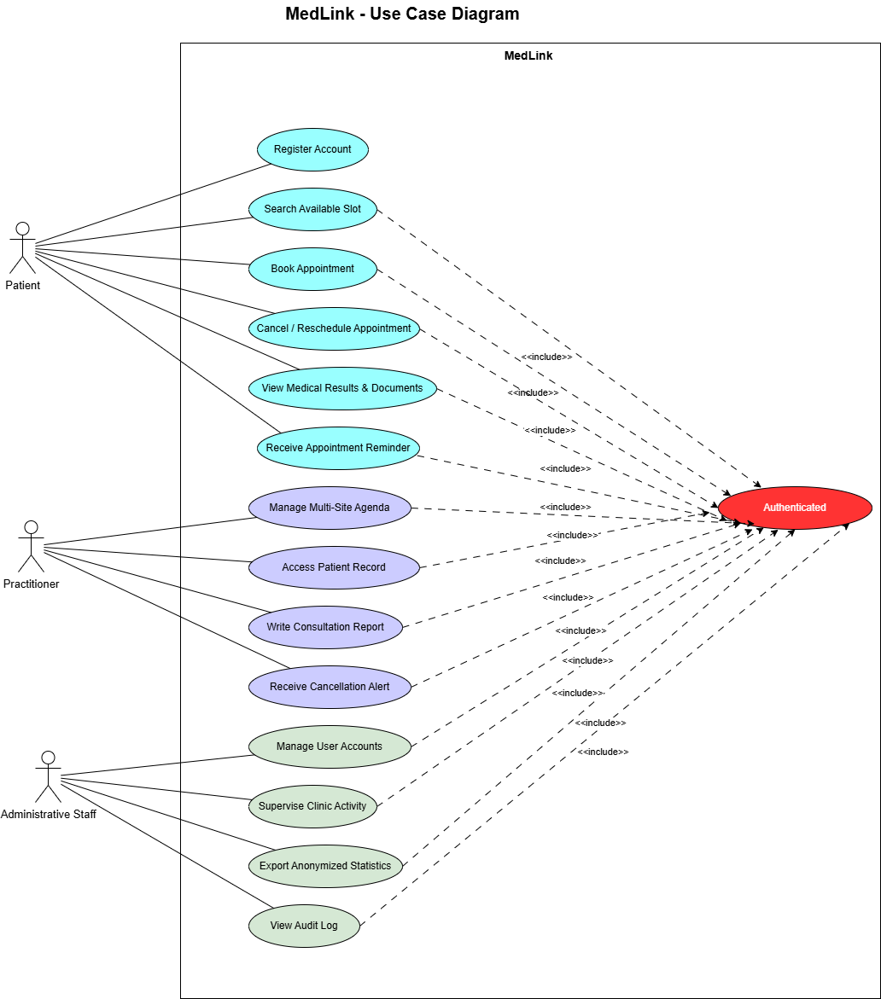

*The scope in one picture. Sprint 2 builds the authentication and access layer behind these
use cases; the appointment, record and reporting flows come later.*

### What “done” meant

A task was not done when the endpoint answered. It was done when a test proved the happy path,
the refusal path, and the access rule — and when the report said what changed and what was
still risky. That standard shaped most of the decisions below.

---

## 2. What shipped

Sprint 2 was split into five sub-sprints so that each one could finish in a working session and
end in a pull request. The table is the honest status at the end of the sprint, not the original
plan.

| Sub-sprint | Scope | State | Main evidence |
|---|---|---|---|
| **0** | Sprint plan, backend-only design, YouTrack re-mapping | Done | `CLAUDE.md`, `plan.md`, this folder |
| **1** | Registration and e-mail verification (routes 1–4) | Done | 69 tests at the time; Postman 45 requests |
| **2** | Login, session, logout, expiry, cookie hardening (routes 5–7) | Login, session, logout and expiry done; cookie hardening merged (#63) | Login, logout, expiry and cookie tests |
| **3** | Staff code / TOTP (routes 8–9) | To do | Design in `plan.md` |
| **4** | Password history, change, forced reset (routes 10–11) | Merged (#88, #89) | `PasswordChangeFunctionalTest` 7, `ForcePasswordResetFunctionalTest` 5, `PasswordHistoryFunctionalTest` 1 test methods; full suite 243/243 |
| **5** | Account management and access matrix (routes 12–16) | Access matrix done early; account operations to do | 48-cell matrix (49 tests); `GET /api/users` locked down |

### Registration and e-mail verification

`POST /api/auth/register` creates a Keycloak account and the matching `users` / `patients` rows
under the same id. `POST /api/auth/verify-email` consumes a single-use, SHA-256-hashed token
that expires after 24 hours. The link in the mail points at the frontend, which posts the token
back to the API — a POST rather than a GET, so mail scanners cannot consume the link by opening it.

The detail we care about most is what happens when the e-mail is already taken. The endpoint
still answers **201** with the same message. The real owner receives a warning mail, at most one
per address every 15 minutes. That closes account enumeration without turning the form into a
dead end for the person who genuinely forgot they had an account.

### Login, session and logout

`POST /api/auth/login` checks CSRF, applies a per-IP rate limit, calls Keycloak with the
password grant, verifies the token signature, issuer and `azp`, provisions the local user if
needed, and starts a new session id. The browser receives a **200** and an HttpOnly,
`SameSite=Strict` session cookie. No token ever reaches JavaScript.

A wrong password, an unknown e-mail and a locked account all receive the same **401
`INVALID_CREDENTIALS`**. An unverified address receives **403 `EMAIL_NOT_VERIFIED`**, and the
Keycloak session opened during the attempt is ended. A disabled account receives **403
`ACCOUNT_DISABLED`**. If Keycloak is down, the API answers **503** rather than pretending the
credentials were wrong.

`POST /api/auth/logout` ends the Keycloak session, invalidates ours and expires the cookie.
The Keycloak call is best effort: if Keycloak is unreachable, the API still returns **204** and
logs the failure. Logging out locally must not depend on a remote service being healthy.

### Passwords

Three changes landed around passwords:

- **History.** Keycloak’s policy now remembers the last three passwords. Reusing one is refused
  with the French message the UI already displays.
- **Change.** `POST /api/auth/password` verifies the current password with a Keycloak password
  grant, then applies the new one through the admin service and ends the temporary session. A
  wrong current password is **401 `INVALID_CURRENT_PASSWORD`**; a policy refusal is **400
  `PASSWORD_POLICY`**.
- **Forced reset.** `POST /api/admin/users/{id}/force-password-reset` is staff-only. It adds
  Keycloak’s `UPDATE_PASSWORD` action and ends the user’s Keycloak sessions. The next login
  returns **200 `{ "passwordChangeRequired": true }`** in a five-minute pending session with no
  authenticated principal. The user can only change the password; the pending session is
  single-use, and a normal login clears the marker.

### Access control

Three roles are enforced: `PATIENT`, `PRACTITIONER`, `ADMINISTRATIVE_STAFF`. They come from
Keycloak groups, never from a request body. A person holds one role. `Patient extends User` in
JPA, so a patient is a user rather than a second profile attached to one.

The access matrix is the part we would keep if we could keep only one test. It reads every
`/api` route from Spring at startup and fails the build if a route has no line in the matrix.
Each cell is a real request against a real Keycloak, with a fresh browser for each caller, so a
logout or a rate limit cannot leak between cells. The four expected answers are `OPEN` (past
security, no 5xx and no redirect), `LOGIN` (401), `FORBIDDEN` (403), and the role-specific
allow.

### Audit, rate limits and the quieter work

- Every **403** is written to an append-only `audit_entries` table. Triggers reject `UPDATE`,
  `DELETE` and `TRUNCATE`; the path is reduced to route words and UUIDs, so an e-mail or a name
  in a URL becomes `{redacted}`.
- Per-IP limits on login, register and resend are counted in PostgreSQL with one atomic
  `INSERT … ON CONFLICT … RETURNING`. Every API instance shares the same counter and no two
  requests read the same count.
- The audit trail, rate limits, session cookie hardening and the Keycloak event log are not
  visible features, but they are the difference between a demo and something we would let a
  clinic use.

### Platform work

The sprint also paid down delivery risk:

- one Compose setup per workflow (dev dependencies on the host; full stack in containers);
- a real CD path that publishes an immutable image digest to GHCR and rolls it out over SSH;
- Terraform aligned with the production profile, including both Keycloak clients and SMTP;
- CI that runs the functional suite, CodeQL, Dependency-Check or a visible Trivy fallback,
  gitleaks, Trivy, ZAP and the AI-disclosure check.

---

## 3. How the system fits together

The architecture is deliberately boring in the places that matter. Identity is a separate
system. Business data is a separate database. The API is the only component that crosses the
boundary between them.

  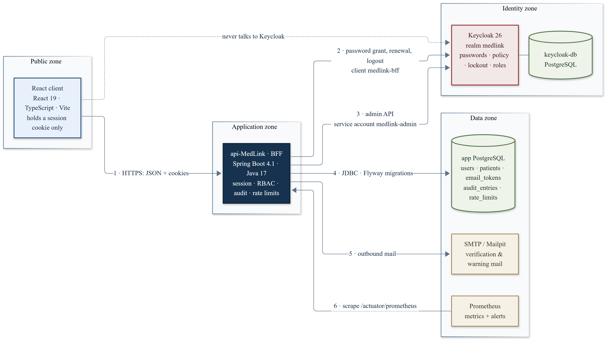

*The runtime view. Six components, two databases, one public door.*

| Component | Responsibility | What it deliberately does not do |
|---|---|---|
| **React client** | Renders the portal; calls the API with cookies and the CSRF header | Store tokens, call Keycloak, decide roles |
| **api-MedLink (BFF)** | Login, session, authorization, provisioning, audit, rate limits, mail | Store passwords, trust a role from the client, expose Keycloak |
| **Keycloak** | Passwords, policy, lockout, groups, roles, events | Serve a page to the end user |
| **`keycloak-db`** | Keycloak’s own PostgreSQL | Share a schema or credentials with the API |
| **App PostgreSQL** | `users`, `patients`, `email_tokens`, `audit_entries`, `rate_limits` | Store password hashes or roles |
| **Mailpit / SMTP** | Verification and warning mail in dev; real SMTP in production | Be on the login path |
| **Prometheus** | Scrapes `/actuator/prometheus`; four alert rules | Replace structured logs or the audit trail |

### Why a BFF, and why two databases

The BFF pattern is often described as a performance pattern. Here it is a **security boundary**.
The browser has one credential — a cookie — and the server keeps the OAuth tokens. An XSS bug can
still act as the user while the page is open, but it cannot read a long-lived token and replay
it later. The session is also the natural place to enforce idle expiry and revocation.

The two databases are separate for a less subtle reason: identity data and clinical data have
different owners, different backup needs and different breach impact. A SQL injection in a
reporting query should not be able to read password material, and a Keycloak upgrade should not
touch patient rows. The API is the only place where the two identities meet, and it meets them
with one rule: `users.id` **is** the Keycloak `sub`.

### The cost we accepted

The password grant is deprecated in OAuth 2.1. We use it anyway, server to server, with a
confidential client. The alternative — Authorization Code + PKCE — is the better standard, but
it requires a Keycloak page in the browser, which breaks the product rule. The decision record
lists the conditions: keep the API on the server, rate-limit login per IP, never log the
password, and revisit the choice if the product ever accepts a Keycloak-hosted login.

A second consequence is that second factors are ours to build. That is sub-sprint 3, not a
Keycloak toggle.

---

## 4. What a login actually does

  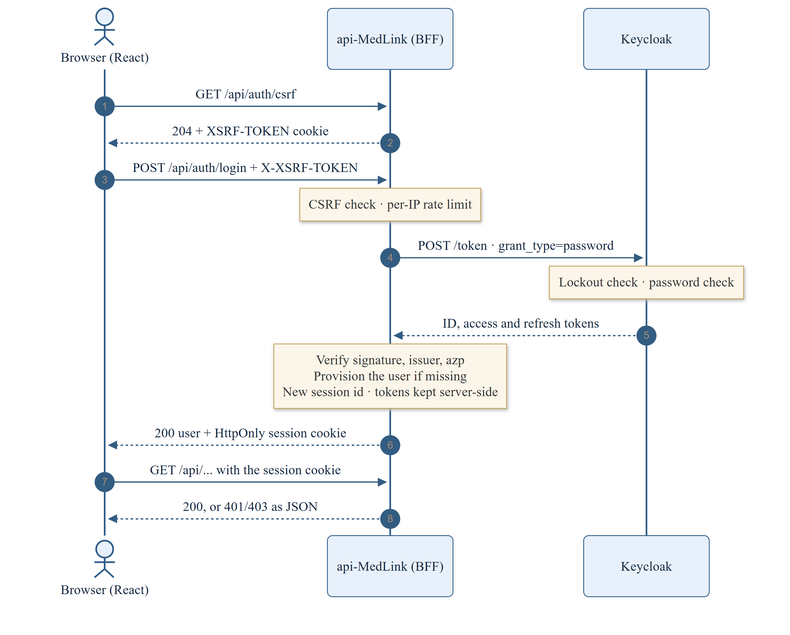

*The happy path. The interesting part is what happens when one step refuses.*

The sequence is short on purpose. There is no redirect, no implicit flow and no token in the
response body. The API does the work that a browser would otherwise do, and it does it with the
same error shape every time.

| Situation | Answer | Why this answer |
|---|---|---|
| Wrong password | `401 INVALID_CREDENTIALS` | Same as an unknown e-mail and a locked account; no enumeration |
| Unknown e-mail | `401 INVALID_CREDENTIALS` | The response must not reveal whether the account exists |
| Locked account | `401 INVALID_CREDENTIALS` | A `423` would confirm the account; Keycloak never locks an unknown one |
| Unverified e-mail | `403 EMAIL_NOT_VERIFIED` | The user needs a different next step, not a generic failure |
| Disabled account | `403 ACCOUNT_DISABLED` | The session must not be created |
| Missing CSRF header | `403 FORBIDDEN` | The cookie is not enough for a write |
| Too many attempts from one IP | `429 TOO_MANY_REQUESTS` + `Retry-After` | Protects the form without saying which e-mail exists |
| Keycloak unreachable | `503` | An outage is not a wrong password |

### Session life

A session ends after **15 idle minutes** on both sides: Tomcat’s session timeout and Keycloak’s
SSO idle timeout. While it lives, the API renews the five-minute access token. If Keycloak
refuses the renewal — account disabled, signed out elsewhere, password reset — the session ends
with **401 `SESSION_EXPIRED`**. The browser gets a code, not an HTML login page, so React can
decide whether to show the login screen, a “signed out elsewhere” message, or a retry.

Logout is best effort in the other direction: our session and cookie always go, even if Keycloak
is slow. That is the right failure mode for a user who wants to leave.

---

## 5. Who can do what

  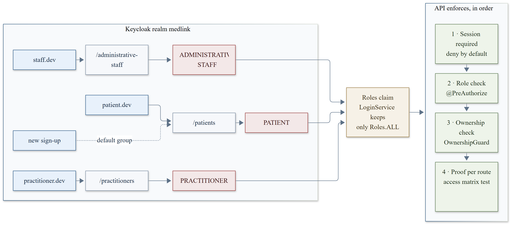

*Groups become roles, and roles become four checks. The matrix is the proof that no route
skips them.*

The API checks access in four layers:

| Layer | Where | What it prevents |
|---|---|---|
| **Deny by default** | `SecurityConfig` | A forgotten route becoming public |
| **Role** | `@PreAuthorize` with `Roles` constants | A patient calling a staff endpoint |
| **Ownership** | `OwnershipGuard` | Reading someone else’s record by changing an id |
| **Proof** | `AccessMatrixFunctionalTest` | A route shipping without an access rule |

The ownership check runs **before** the lookup. A stranger gets the same `403` whether the id
exists or not; only staff get a `404` for an unknown id. That one ordering decision removes a
quiet enumeration channel.

An excerpt from the matrix:

| Route | Anonymous | Patient | Practitioner | Staff |
|---|---|---|---|---|
| `GET /api/auth/csrf` | OPEN | OPEN | OPEN | OPEN |
| `POST /api/auth/register` | OPEN | OPEN | OPEN | OPEN |
| `POST /api/auth/verify-email` | OPEN | OPEN | OPEN | OPEN |
| `POST /api/auth/verify-email/resend` | OPEN | OPEN | OPEN | OPEN |
| `POST /api/auth/login` | OPEN | OPEN | OPEN | OPEN |
| `POST /api/auth/logout` | LOGIN | OPEN | OPEN | OPEN |
| `GET /api/users` | LOGIN | FORBIDDEN | FORBIDDEN | OPEN |
| `GET /api/users/{id}` | LOGIN | FORBIDDEN | FORBIDDEN | OPEN |
| `DELETE /api/users/{id}` | LOGIN | FORBIDDEN | FORBIDDEN | OPEN |
| `GET /api/users/_health` | LOGIN | OPEN | OPEN | OPEN |

The matrix is not a snapshot in a document. It is a test class. A new endpoint without a line
fails `everyApiRouteHasALineInTheMatrix` and names the route in the failure. That is the
difference between an access-control table and an access-control guarantee.

### Staff are not Keycloak administrators

One finding from the threat-model review is worth calling out. `ADMINISTRATIVE_STAFF` used to be
a composite role with `manage-users`, `view-users`, `query-users`, `query-groups` and
`view-realm`. With those rights, a staff member could use Keycloak’s public `admin-cli` client
and manage accounts outside the API — no ownership check, no audit trail.

The role is now a plain role. Staff manage accounts through the API, where the rules and the
audit trail apply. Only the service account `medlink-admin` keeps realm-management rights. The
fix was proved red first: the old composite let `staff.dev` list users, create a user and read
the realm; after the change all three answer `403`.

---

## 6. Where the data lives, and what we refuse to store

| Store | Holds | Why it is separate |
|---|---|---|
| **Keycloak** | Passwords, password policy, lockout state, groups, roles, sessions, events | A proven identity server; we write no password code |
| **App PostgreSQL** | `users`, `patients`, `email_tokens`, `audit_entries`, `rate_limits` | Business data and security evidence owned by the API |
| **`keycloak-db`** | Keycloak’s schema | Identity data must not share credentials or backups with clinical data |
| **Browser** | `JSESSIONID` (HttpOnly) and `XSRF-TOKEN` (readable) | One credential, no tokens |
| **Mailpit / SMTP** | Verification links and warning messages | Mail is a side effect, not part of the session |

We deliberately do **not** store:

- a password or a password hash in the API;
- a role on the user row;
- an OAuth token in the browser;
- a raw e-mail, name or token in the audit path;
- a per-account login lock of our own (Keycloak already has one, and a second one would let an
  attacker lock an account faster).

### The migration story

Flyway owns the schema. Migrations `V1`–`V8` are on `master`; `V8` adds the shared
`rate_limits` table. The numbering rule is part of the review: the migration that merges first
takes the lower number, because a database that already applied `V9` will refuse a `V8` that
arrives later. It is a small process rule that prevents a class of production incidents.

---

## 7. How we know it works

  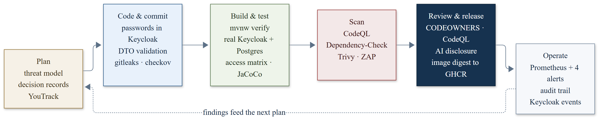

*Security is not a phase at the end. It is a set of gates along the path.*

### Tests that behave like a browser

Most of the meaningful tests are functional. They start the API on a real port, a real Keycloak
with the same realm file as dev, a real PostgreSQL and Mailpit. They drive the API over HTTP,
with their own cookie jar and their own `X-Forwarded-For`, and they act in Keycloak through its
admin API when the scenario needs it.

That choice is slower than mocking Keycloak, but it catches the bugs that matter: a missing CSRF
header, a cookie that is not sent back, an unverified e-mail that is accepted, a role that leaks
through a token, a session that survives a logout. The first Postman run found a real bug that
MockMvc could not see: a refused CSRF token answered **401** to a real client because the error
forward needed a login.

| Checkpoint | Result |
|---|---|
| Password change (MLink-91) | 7 functional test methods (`PasswordChangeFunctionalTest`), all green |
| Forced password reset (MLink-88) | 5 functional test methods (`ForcePasswordResetFunctionalTest`), all green |
| Full suite at `d7b0585` (2026-10-23) | 243/243, normal and reverse class order |
| Access matrix | 48 route × role cells + 1 route-coverage test = 49 tests; every `/api` route covered |
| Postman / Newman, through folder 6 | 67 requests, 178 assertions, 0 failures |
| Registration slice, earlier checkpoint | 69 tests; 45-request Postman run; 154 assertions |

The team also uses mutation checks as a habit: break the rule a test guards, watch the test go
red, restore the rule. A test that cannot fail is documentation, not proof.

### Delivery and operations

The CI pipeline runs `./mvnw -B verify`, CodeQL, Dependency-Check (with a visible, policy-gated
Trivy fallback when no NVD key is available), gitleaks, Trivy and a ZAP baseline. The CD workflow
publishes an image by digest to GHCR, copies the Compose file and realm to the target over SSH,
starts the API, verifies the running digest and polls `/actuator/health`. If the health check
fails, the last 200 log lines are printed.

Prometheus scrapes the API every 15 seconds and four alert rules cover app down, 5xx rate, p95
latency and heap pressure. The alerts are only useful once Alertmanager has a target; that is
listed as a gap, not hidden.

---

## 8. The system on screen

The screenshots below were taken from the running dev stack: the API on `:8080`, Keycloak on
`:8180`, Mailpit on `:8025`, and the React shell on `:3000`. They are evidence, not mockups.

### The API contract

  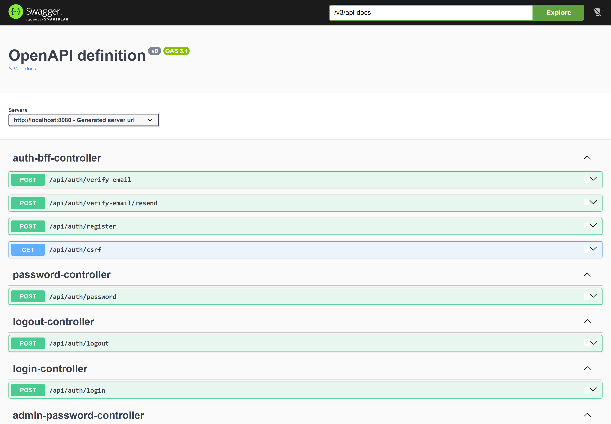

*Swagger UI: the public surface, grouped by controller. The contracts are generated from the
code, so a controller change is visible in the documentation immediately.*

The list is short on purpose. There is no `/api/patients` or `/api/appointments` yet, because
Sprint 2 is the access layer, not the clinical surface. The controllers are split by
responsibility rather than by URL prefix, which keeps login, logout, password and verification
changes from sharing one class.

  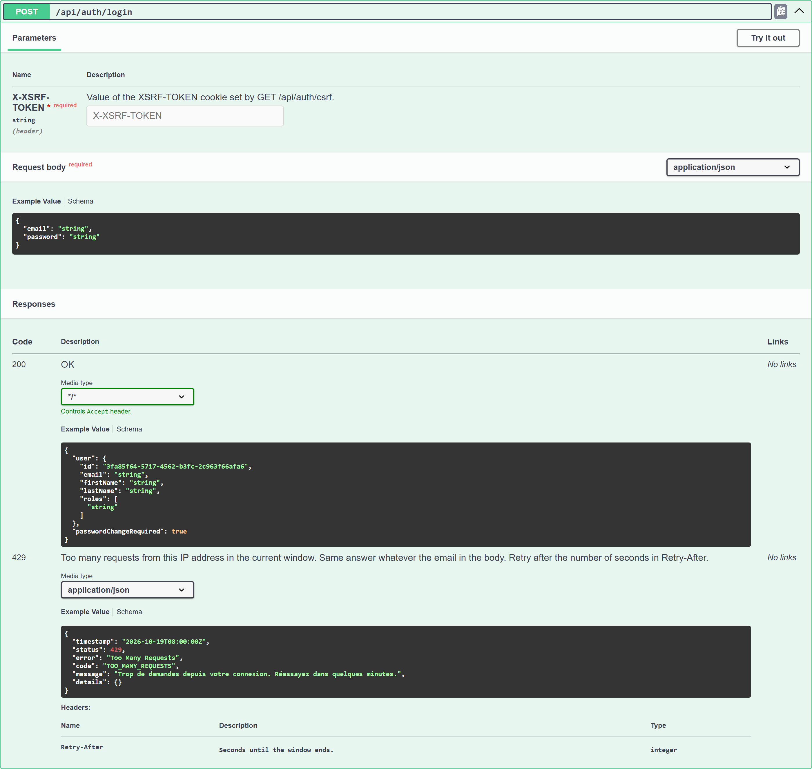

*The login contract. The required `X-XSRF-TOKEN` header and the `429` response are part of the
documented contract, not an implementation detail.*

The detail matters more than the summary. A caller can see the CSRF header, the `200` shape and
the `429` shape before writing a client. That reduces the chance that the frontend invents its
own error contract.

### Keycloak

  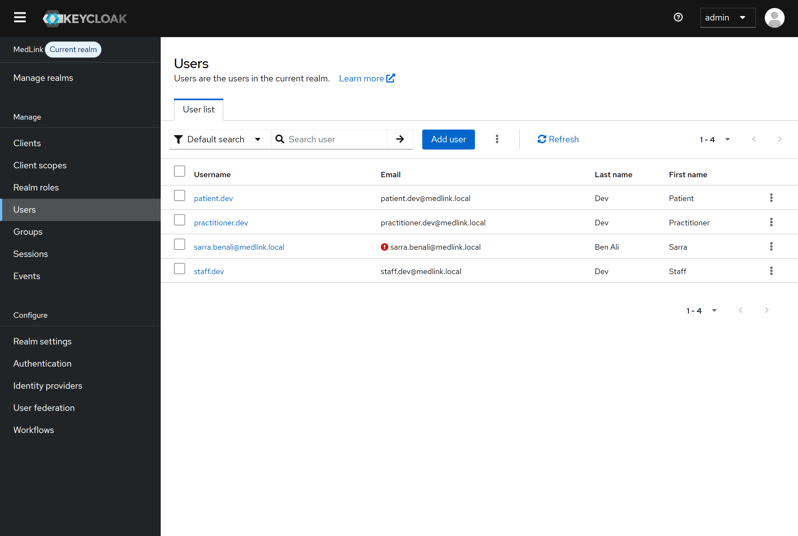

*The `medlink` realm: the three development users and a patient registered through the API. The
new account is created by the service account, not by a human in the console.*

The interesting row is the fourth one. `sarra.benali@medlink.local` exists because a registration
request created it. The console is where we inspect the result, not where the account came from.

  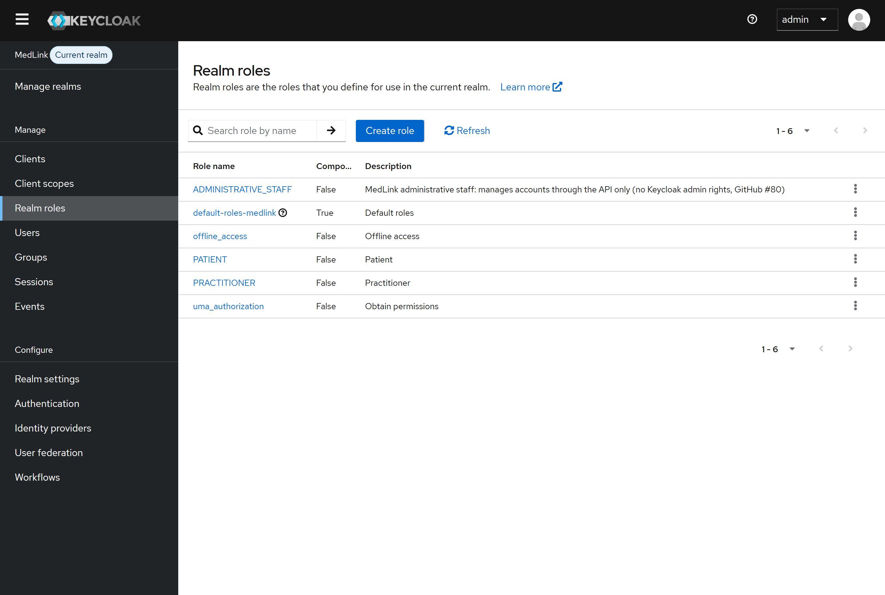

*Three business roles, plus Keycloak’s own defaults. `ADMINISTRATIVE_STAFF` is a plain role: no
realm-management rights.*

The role list is also a boundary. `ADMINISTRATIVE_STAFF` can manage accounts through
`/api/users`, but it cannot open the Keycloak admin API. Staff get the workflow, not the
identity provider's master key.

  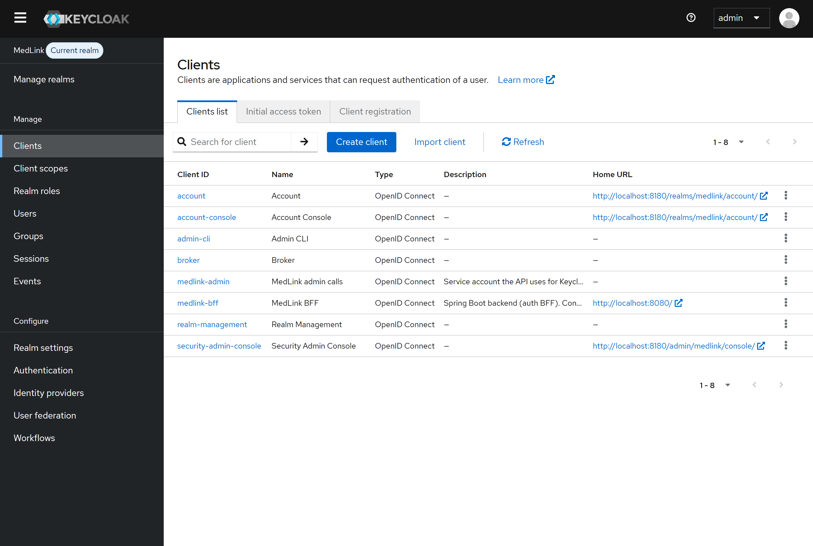

*Two clients, two jobs: `medlink-bff` for the user login, `medlink-admin` for account
operations. The separation is what lets staff stay out of the Keycloak admin API.*

`medlink-bff` is the confidential client the API uses for the password grant; `medlink-admin` is
the service account for account operations. Only the API holds the second secret. A staff
browser never sees either one.

### The verification mail

  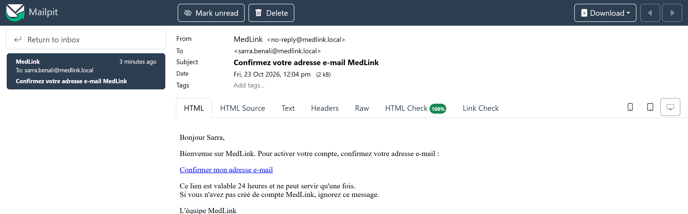

*A real verification mail produced by a real registration. The link is single-use, expires in
24 hours, and points at the frontend, which posts the token back to the API.*

The mail is in French because the clinic's users are French-speaking; the template is not the
point. The point is that the token arrives as a link, not as a password, and that Mailpit lets
us test the whole path without a real mailbox.

### The React client

  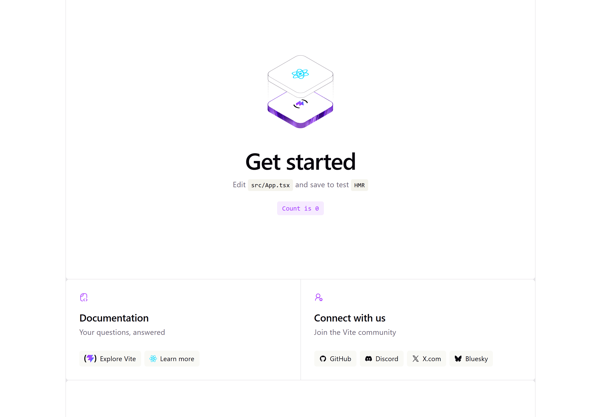

*The current client is still the Vite shell. The sprint delivered the API and identity layer it
will consume; the login, verification and password screens are the next UI milestone. We would
rather show the shell than pretend the screens exist.*

The empty shell is deliberate. The repository contains the client, the API and the identity
configuration; the sprint scope stopped at the API boundary. The next UI milestone can now be
built against a contract that already exists.

---

## 9. Trade-offs, limits and what comes next

### Decisions we would defend

| Decision | What it buys | What it costs |
|---|---|---|
| Keycloak owns identity | Proven password policy, lockout, events, admin UI; no password code of ours | One more service to run, back up and upgrade |
| BFF with server-side tokens | XSS cannot steal a token; one place to revoke a session | Server sessions; shared session storage before a second instance |
| Password grant, server to server | No Keycloak page ever reaches the user | The API sees passwords; second factors are ours to build |
| Same answer for unknown e-mail | No account enumeration | A slower, less specific error for a legitimate user |
| Per-IP limits in PostgreSQL | Shared across instances, race-free, no Redis | A fixed window allows a burst at the edge; NAT users share a count |
| Append-only audit table | Raw SQL cannot rewrite the trail | The table owner still can; separate roles are future work |
| Functional tests over mocks | Proof at the HTTP boundary, like a browser | Slower CI; Docker required |

### What is still open

| Priority | Item | Why it matters |
|---|---|---|
| **Now** | React login, verification and password screens | The API is ready; the product still needs a usable front door |
| **Now** | Second factor for practitioners and staff (TOTP, MLink-62/63) | A password alone is not enough for clinical access |
| **Next** | Account management: create, disable, list, audit (sub-sprint 5) | Staff can reset a password but cannot yet run the full account lifecycle |
| **Next** | Reverse proxy: TLS, HSTS, CSP, `TRUSTED_PROXIES`, Keycloak not public | The production topology in `docs/DEPLOYMENT.md` assumes this |
| **Next** | Backup and restore for both databases (GitHub #67) | A named volume is not a backup |
| **Later** | Separate database roles for the audit trail (GitHub #57) | Append-only should survive a compromised application role |
| **Later** | Shared sessions before a second API instance | In-memory Tomcat sessions do not scale horizontally |
| **Watch** | PostgreSQL 18 in the dev compose file | Known dev-volume issue (#74); a fresh volume works in the clean run |
| **Watch** | Metrics and API docs are public in production (#49, #65) | Convenient now; unacceptable for a clinic deployment |

### Known engineering limits

- Only Keycloak sessions are ended by a forced reset. API sessions end at their next token
  renewal through `SessionValidityFilter`; the access token lives five minutes.
- The rate limiter uses a fixed window. It can let up to twice the limit through around a window
  edge. That is enough against floods and much simpler than a sliding log.
- The audit trail protects against ordinary SQL, not against the table owner. Flyway and the
  application currently use the same database role.
- `X-Forwarded-For` is trusted only from `TRUSTED_PROXIES`, loopback by default. Staging and
  production must set it to the real proxy address, and the proxy must append the client
  address rather than pass a client-supplied header through.
- The React client is a shell. There is no claim in this report that the UI is finished.

---

## 10. How the team worked

The sprint followed a simple loop: pick one YouTrack ticket, branch from `master`, write the
failing test, make it pass, prove the refusal path, open a PR, update this report in the same
PR. No stacked PRs — a lesson learned the hard way when one landed on the wrong branch and had
to be re-landed.

Three people shared the work: Mohamed on identity, sessions, passwords and the platform; Ahlem
on the React pages and the scripted lockout checks; Youssef on login/logout, session expiry and
the setup scripts. Shared files (`SecurityConfig`, `AuthBffController`, `FunctionalTestBase`,
the realm file, the setup scripts) were announced on the other person’s ticket before touching
them.

The repository rules do more work than any meeting:

- `master` is protected; a code-owner review and CodeQL are required;
- every PR declares AI assistance, and an AI-assisted PR needs a human review acknowledgement;
- a new endpoint needs a DTO, a mapper, a service, a controller, a matrix line, a test for the
  right role and a test for the wrong role;
- a schema change is the next free `V<N>`, never an edit to a merged migration;
- a task is done when a test proves it.

That last rule is the reason this report can show evidence instead of adjectives.

---

## Appendix A — route inventory

| Method | Path | Access | Purpose |
|---|---|---|---|
| `GET` | `/api/auth/csrf` | Public | Issue the CSRF cookie |
| `POST` | `/api/auth/register` | Public | Create a patient account and send verification |
| `POST` | `/api/auth/verify-email` | Public | Consume a verification token |
| `POST` | `/api/auth/verify-email/resend` | Public | Send a new verification link |
| `POST` | `/api/auth/login` | Public | Start a session through Keycloak |
| `POST` | `/api/auth/logout` | Session | End the Keycloak and API sessions |
| `POST` | `/api/auth/password` | Session | Change the current password |
| `GET` | `/api/users/_health` | Session | Cheap “is my session alive” check |
| `GET` | `/api/users` | Staff | List users |
| `GET` | `/api/users/{id}` | Owner or staff | Read one user |
| `DELETE` | `/api/users/{id}` | Staff | Delete the local user row |
| `POST` | `/api/admin/users/{id}/force-password-reset` | Staff | Force a password change at next login |

Planned but not in this sprint: `/api/auth/me` (MLink-53), staff code / TOTP (MLink-62/63), and
the account-management routes (sub-sprint 5).

## Appendix B — glossary

| Term | Meaning |
|---|---|
| **BFF** | Backend for Frontend: the API runs the login and keeps the tokens; the browser holds a session cookie |
| **OIDC / OAuth 2.0** | The identity and authorization protocols Keycloak speaks |
| **Password grant (ROPC)** | The client sends the user’s password to the token endpoint. Deprecated by OAuth 2.1; used here server to server as an accepted exception |
| **PKCE** | Proof Key for Code Exchange, part of the Authorization Code flow; not used by our login |
| **Realm** | An isolated Keycloak space with its own users, roles, groups and clients (`medlink`) |
| **Client** | An application registered in Keycloak: `medlink-bff` for login, `medlink-admin` for account operations |
| **JWKS** | The public keys Keycloak publishes so the API can verify token signatures |
| **IDOR** | Insecure Direct Object Reference: reading someone else’s data by changing an id; stopped by `OwnershipGuard` |
| **SAST / SCA / DAST** | Static code analysis / dependency vulnerability scanning / attacks against the running app |

## References

- [`report.md`](report.md) — the complete engineering log, PR by PR
- [`plan.md`](plan.md) — endpoint contracts, sub-sprint breakdown, decisions
- [`README.md`](README.md) — how a sprint session runs
- [`../../ARCHITECTURE.md`](../../ARCHITECTURE.md) — architecture, security model, ISO 27001 mapping
- [`../../../security/threat-model.md`](../../../security/threat-model.md) — STRIDE threats and controls
- [`../../decisions/0001-login-password-grant.md`](../../decisions/0001-login-password-grant.md) — why the password grant
- [`../../DEPLOYMENT.md`](../../DEPLOYMENT.md) — environments, secrets, rollout and rollback
