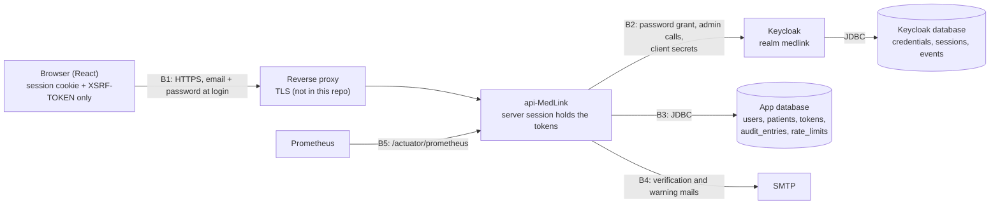

# Threat model — api-MedLink

| | |
|---|---|
| Scope | the API (`api-MedLink`), its Keycloak realm `medlink`, its two PostgreSQL databases, CI/CD |
| Method | STRIDE, per trust boundary; every control points to the code or file that implements it |
| Updated | 2026-10-20 (GitHub #66), against `master` |
| Login design | password grant, server to server: a consciously accepted exception, see [decision record 0001](../docs/decisions/0001-login-password-grant.md) and GitHub #50 |

**Status legend:** ✅ in place and tested · 🟡 partial or accepted risk · ⏳ planned (ticket) · ❌ gap

## 1. System and trust boundaries

| Boundary | What crosses it | Main risks |
|---|---|---|
| **B1** browser → API | the email and **password** at login; the session cookie; personal data | stolen session, CSRF, brute force, enumeration, another user's data |
| **B2** API → Keycloak | the password (password grant, client `medlink-bff`); admin calls (service account `medlink-admin`) | stolen client secrets, Keycloak rights used outside the API |
| **B3** API → database | personal data, the audit trail | injection, tampering with the trail, default credentials |
| **B4** API → SMTP | links with single-use tokens | mail bombing, leaked links |
| **B5** monitoring → API | metrics | internals disclosed to anyone |
| **CI/CD** | source, images, secrets in GitHub Environments | vulnerable dependencies, leaked secrets |

## 2. Assets

| Asset | Where | Why it matters |
|---|---|---|
| Passwords | Keycloak only (hashed); **in the API's memory during a login** | account takeover |
| Keycloak tokens | the server session only, never the browser | act as the user towards Keycloak |
| Session cookie | the browser (HttpOnly) | the browser's only credential |
| Personal and health data (PII/PHI) | app database (`users`, `patients`, later appointments and records) | confidentiality, GDPR, health-data rules |
| Audit trail | `audit_entries` (append-only) | proof of who was refused what (MLink-17) |
| Email tokens | `email_tokens` (SHA-256 hash only, 24 h, single use) | verify someone else's email |
| Secrets | environment variables, GitHub Environments: `KC_BFF_CLIENT_SECRET`, `KC_ADMIN_CLIENT_SECRET`, DB and Keycloak admin passwords | full access to identity or data |

## 3. Assumptions

- TLS ends at a reverse proxy in front of the API and Keycloak; the proxy is not described in this repo yet
  (Terraform #53). Behind it, `TRUSTED_PROXIES` must name the proxy, or per-IP limits count the proxy.
- One API instance: sessions live in Tomcat's memory. More instances need shared sessions first.
- Dev users (`*.dev`) are imported in every environment and must be deleted in staging and prod.

## 4. Threats and controls

### Spoofing

| # | Threat | Controls (where) | Status | Open work |
|---|---|---|---|---|
| S1 | Brute force or credential stuffing on login | Keycloak lockout: 5 failures → 15 min (realm `bruteForceProtected`, `LoginLockoutFunctionalTest`); per-IP limit 30 / 5 min → 429 (`security/RateLimitFilter`, `RateLimitFunctionalTest`); password policy: 12+ characters, mixed, not the email (realm) | ✅ | |
| S2 | A password alone opens a staff or practitioner account | none yet: one factor for every role | ⏳ | staff code (TOTP): MLink-62/63; admin identities: GitHub #68 |
| S3 | Session stolen by a script (XSS) | session cookie HttpOnly, tokens never sent to the browser (`security/LoginSessions`, `LoginFunctionalTest`) | ✅ | a Content-Security-Policy is not set (proxy or API) ❌ |
| S4 | Session fixation | a new session id at every login (`LoginSessions.open`, `SessionCookieFunctionalTest`) | ✅ | |
| S5 | Cross-site request forgery | session cookie `SameSite=Strict`; CSRF token on every write (`config/SecurityConfig`, SPA cookie mode; `OwnershipFunctionalTest`) | ✅ | |
| S6 | Session used after logout, after a disabled account, or left open | logout ends our session and Keycloak's (`LogoutController`, `LogoutFunctionalTest`); 15 idle minutes (`SessionExpiryFunctionalTest`); a refused token renewal ends the session within the 5-minute token life (`security/SessionValidityFilter`, `SessionFollowsAccountFunctionalTest`) | ✅ | |
| S7 | Cookie sent over plain HTTP | `Secure` cookies in staging and prod (`application-{staging,prod}.yml`, `SecureCookiesIntegrationTest`) | ✅ | HSTS at the proxy ❌ |
| S8 | Account enumeration | the same status and body for any email: register 201, resend 202, login 401 also for a locked account (`SignupFunctionalTest`, `LoginFunctionalTest`) | ✅ | |

### Tampering

| # | Threat | Controls (where) | Status | Open work |
|---|---|---|---|---|
| T1 | SQL injection | JPA with bound parameters, Bean Validation on every request DTO (`dto/`) | ✅ | |
| T2 | Audit trail changed or deleted | triggers refuse `UPDATE`, `DELETE`, `TRUNCATE` (`V7__audit_entries.sql`, `AuditFunctionalTest`) | 🟡 | the table's owner is also the runtime role and can drop the triggers: separate roles, GitHub #57 |
| T3 | Schema changed outside review | Flyway only, `ddl-auto: validate` in every profile | ✅ | |
| T4 | Realm changed by hand and lost or unreviewed | the realm is code (`keycloak/realm-medlink.json`), reviewed in PRs; the setup script re-imports it in dev | 🟡 | in staging and prod the console stays the source of truth after the first import |

### Repudiation

| # | Threat | Controls (where) | Status | Open work |
|---|---|---|---|---|
| R1 | A refused access leaves no trace | every 403 writes `ACCESS_DENIED` with the user, the IP and a redacted path (`security/JsonAccessDeniedHandler`, `service/AuditService`) | ✅ | |
| R2 | Logins and account changes leave no trace in our trail | Keycloak events: `LOGIN`, `LOGIN_ERROR`, `LOGOUT`, lockouts, password changes, kept 30 days (realm), and admin events | 🟡 | logins and account operations in `audit_entries`: MLink-114, MLink-72; reading the trail: MLink-115 |

### Information disclosure

| # | Threat | Controls (where) | Status | Open work |
|---|---|---|---|---|
| I1 | **The password passes through the API** (password grant) | sent to Keycloak at once and never stored; never logged (`LoginRequest.toString` hides it); TLS on B1 (assumption) | 🟡 accepted | the risk accepted in decision 0001; revisit if passkeys are wanted |
| I2 | Tokens leak | kept in the server session; `KeycloakTokens.toString` hides them; ID tokens checked: signature (JWKS), issuer, `azp` (`service/KeycloakLoginClient`, `KeycloakLoginClientTest`) | ✅ | |
| I3 | A user reads another user's data (IDOR) | `security/OwnershipGuard` checks before the lookup, the same 403 whether the id exists or not (`OwnershipFunctionalTest`) | ✅ | practitioner ↔ own patients only: with the appointment domain (MLink-97 onward) |
| I4 | Metrics and API documentation public in production | actuator limited to `health,info,prometheus`; in staging and prod it is served only on the private management port 9000, which no compose file publishes, and the public port keeps `/livez` and `/readyz` (`{"status":"UP"}` only) (`ManagementPortIntegrationTest`, `ManagementPortConfigTest`, GitHub #49) | 🟡 | Swagger and `/v3/api-docs` still public: GitHub #65 |
| I5 | Personal data in logs or the audit trail | no request body, query string, password or token is logged; the audit path keeps only route words and UUIDs (`security/RouteWords`) | ✅ | |
| I6 | Internal errors leak details | one error shape, `500 INTERNAL_ERROR` without SQL or stack (`exception/GlobalExceptionHandler`, `ErrorBody`) | ✅ | |
| I7 | Secrets in git or defaults in production | secrets from the environment only; gitleaks before commit and in CI (`secrets-scan.yml`); Keycloak client secrets have no default outside dev | 🟡 | the datasource still falls back to `myuser` / `secret` in staging and prod: GitHub #64 |

### Denial of service

| # | Threat | Controls (where) | Status | Open work |
|---|---|---|---|---|
| D1 | Floods on public endpoints | per-IP limits on login, register, resend, counted in Postgres and shared by every instance (`repository/RateLimitStore`) | ✅ | limits on other routes and at the proxy ❌ |
| D2 | Someone locks a user out with wrong passwords | the lock is temporary (15 min), never permanent; per-IP limits slow it down | 🟡 accepted | |
| D3 | Mail bombing through register or resend | one warning mail per address per 15 min, one new link per burst (`MailThrottle`), plus per-IP limits | ✅ | |

### Elevation of privilege

| # | Threat | Controls (where) | Status | Open work |
|---|---|---|---|---|
| E1 | A role or an id forged in a request | roles only from the signed token, filtered to the three MedLink roles (`security/Roles`, `LoginService`); never a role or the caller's id from a body | ✅ | |
| E2 | A new endpoint without an access rule | deny by default (`SecurityConfig`), `@PreAuthorize`; the role × route matrix fails the build on a route without a line (`functional/AccessMatrixFunctionalTest`, MLink-60, #77; `OPEN` cells also reject 5xx and redirects) | ✅ | |
| E3 | **Staff use Keycloak's admin rights directly** | the realm role `ADMINISTRATIVE_STAFF` holds no `realm-management` right; only the API's service account `medlink-admin` does (`keycloak/realm-medlink.json`, `StaffKeycloakRightsFunctionalTest`: staff get 403 from Keycloak's admin API; GitHub #80, fixed in #81) | ✅ | staging and prod: remove the five old role mappings by hand (the realm is imported only into an empty database) |
| E4 | The Keycloak console or bootstrap admin taken over | the bootstrap admin is separate from the realm | ❌ | MFA for admin identities (GitHub #68); the browser no longer needs Keycloak, so its port can be closed to the public in production |

### Supply chain and operations

| # | Threat | Controls (where) | Status | Open work |
|---|---|---|---|---|
| O1 | A vulnerable dependency or image | Dependabot weekly; OWASP Dependency-Check fails on CVSS ≥ 7; Trivy fails on HIGH/CRITICAL; CodeQL (`.github/workflows/`) | ✅ | |
| O2 | An unreviewed change reaches `master` | code-owner review and CodeQL required on `master` (ruleset); CODEOWNERS on security paths | ✅ | a version bump in compose is not covered by the tests (GitHub #74) |
| O3 | Data lost | named volumes only | ❌ | backup and tested restore of both databases: GitHub #67 |
| O4 | An attack goes unnoticed | Prometheus metrics and 4 alert rules | 🟡 | alerts reach no one (no Alertmanager target); no central log store |

## 5. Accepted risks

Decided by the team and recorded in [decision record 0001](../docs/decisions/0001-login-password-grant.md)
(GitHub #50): **the login keeps the password grant**. The API therefore sees passwords (I1), every second
factor and password rule is ours to build (S2), and passkeys are not possible. Its conditions are met:
per-IP rate limits (S1, D1) and the record linked from the sprint report. The record keeps the migration
plan to Authorization Code + PKCE, should the decision be revisited. Also accepted: a temporary lockout can
be triggered by someone else (D2).

## 6. Open work, by priority

| Priority | Item | Tracked |
|---|---|---|
| 1 | Staff and practitioner second factor (S2); MFA for admin identities (E4) | MLink-62/63, GitHub #68 |
| 1 | No default database credentials outside dev (I7) | GitHub #64 |
| 2 | API docs not public in production (I4) | GitHub #65 |
| 2 | Separate database roles for the audit trail (T2) | GitHub #57 |
| 2 | Logins and account operations in the audit trail (R2) | MLink-114, MLink-72 |
| 2 | Backups with a tested restore (O3) | GitHub #67 |
| 3 | Reverse proxy described: TLS, HSTS, CSP, `TRUSTED_PROXIES` (S3, S7, D1) | Terraform GitHub #53 |
| 3 | Alert routing and a central log store (O4) | not tracked yet |
